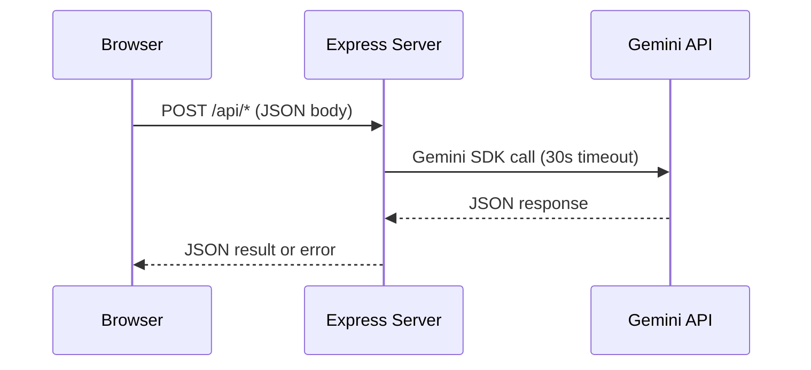
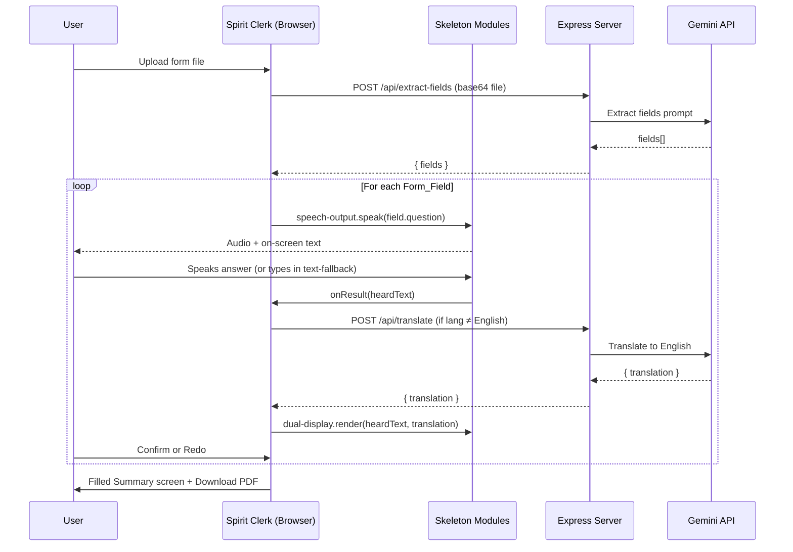
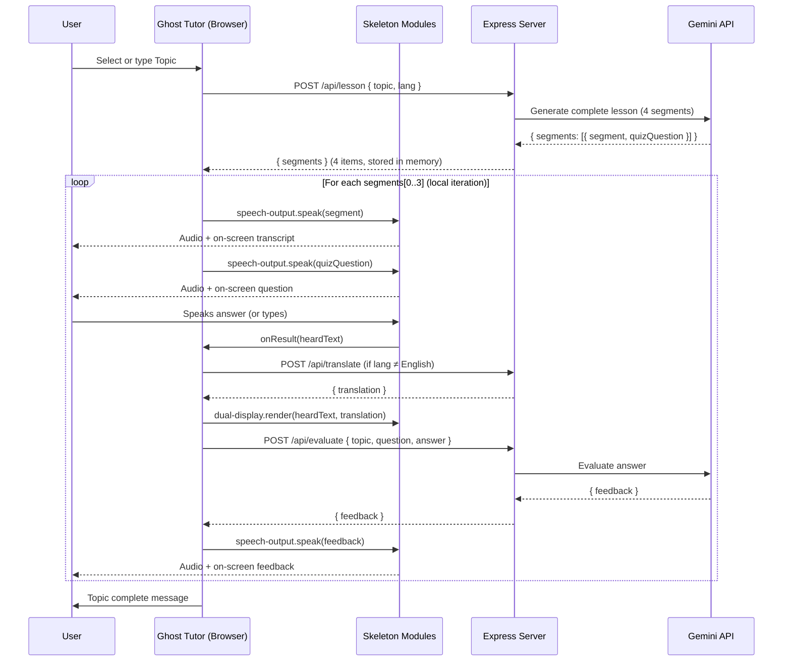

# Design Document

## Overview

Phantom Voice Kit is a voice-first web application skeleton built with plain HTML, CSS, and vanilla JavaScript ES modules on the frontend and a single Node.js Express server on the backend. The server serves all static files and proxies every Google Gemini API call so the API key never reaches the browser. Two applications — Spirit Clerk (voice-guided form filling) and Ghost Tutor (spoken topic lessons with quizzes) — are built on top of a shared `/skeleton` folder that provides speech input, speech output, language selection, dual-language display, text fallback, Halloween theming, and an API client module. A home screen at `index.html` ties both apps together with a shared language selector.

---

## Architecture

Three layers interact through clearly defined boundaries:

```
┌─────────────────────────────────────────────────┐
│  Browser                                        │
│  index.html / apps/spirit-clerk / apps/ghost-   │
│  tutor                                          │
│  Vanilla JS ES Modules, Web Speech API, jsPDF   │
│                │  HTTP POST /api/*              │
└────────────────┼────────────────────────────────┘
                 │
┌────────────────▼────────────────────────────────┐
│  Express Server  (http://localhost:3000)        │
│  server/index.js — static file serving +        │
│  route handlers                                 │
│                │  HTTPS Gemini SDK call         │
└────────────────┼────────────────────────────────┘
                 │
┌────────────────▼────────────────────────────────┐
│  Google Gemini API                              │
│  @google/genai, model from GEMINI_MODEL env var │
└─────────────────────────────────────────────────┘
```



The browser never calls Gemini directly. All AI interactions go through the Express server. The Express server does NOT mount `express.static` on the repository root. The Home Screen is served explicitly with:
```js
app.get('/', (req, res) => res.sendFile(path.join(ROOT, 'index.html')));
```
`express.static` is mounted only for `/skeleton` and `/apps`:
```js
app.use('/skeleton', express.static(path.join(ROOT, 'skeleton')));
app.use('/apps',     express.static(path.join(ROOT, 'apps')));
```
This ensures `server/`, `.kiro/`, `.env`, `package.json`, and `LICENSE` are never reachable from the browser.

---

## Folder Structure

```
/
├── skeleton/
│   ├── speech-input.js
│   ├── speech-output.js
│   ├── language-dropdown.js
│   ├── dual-display.js
│   ├── text-fallback.js
│   ├── nav-menu.js
│   ├── voice-commands.js   ← pure: matchCommand(text, words), parseWords(str), normalize(text)
│   ├── i18n.js
│   ├── locales/
│   │   ├── en.json
│   │   └── ta.json, hi.json, ... (20 files, one per language code)
│   ├── theme.css
│   └── api-client.js
│
├── apps/
│   ├── spirit-clerk/
│   │   ├── index.html
│   │   ├── app.js
│   │   └── style.css
│   └── ghost-tutor/
│       ├── index.html
│       ├── app.js
│       └── style.css
│
├── server/
│   ├── index.js          ← serves / via sendFile; mounts /skeleton and /apps via express.static
│   ├── gemini.js          ← shared Gemini client, timeout, JSON parsing
│   └── routes/
│       ├── translate.js
│       ├── extract-fields.js
│       ├── lesson.js
│       └── evaluate.js
│
├── index.html          ← Home Screen
├── .env                ← not committed
├── .env.example
├── .gitignore
├── LICENSE
├── package.json
└── README.md
```

---

## Skeleton Modules

### `speech-input.js`

Wraps the browser `SpeechRecognition` API. Exposes `createSpeechInput({ lang, onResult, onError })` which returns a controller object with `start()` and `stop()` methods. Internally configures `recognition.lang` to the BCP-47 code, sets a 30-second inactivity timer that calls `stop()` automatically and fires `onError({ inactivity: true })` to signal a silence timeout (distinct from recognition failure). Tracks a retry counter (max 3) for recognition failures before invoking `onError` with a `{ fallbackOnly: true }` flag. On a successful result, calls `onResult(heardText)` with the transcript string. `createSpeechInput` first checks for `window.SpeechRecognition` or `window.webkitSpeechRecognition`; if neither exists it returns `{ supported: false }`, and the app hides the microphone button, shows a short message that voice input is not available in this browser, and uses Text_Fallback only (R2.6).

### `speech-output.js`

Wraps `window.speechSynthesis`. Exposes `createSpeechOutput({ lang })` which returns an object with `speak(text, { onStart, onEnd, onError })` and `stop()`. On `speak()`, voice choice is delegated to the pure function `selectVoice(voices, bcp47)`, which prefers a voice whose name contains "Natural", then one whose name contains "Online", then the first matching voice (R3.5). If no matching voice is found, it calls `onError({ audioUnavailable: true })` and returns without speaking, leaving the caller to display the text. Fires `onStart` synchronously before audio begins so the UI can show the transcript text within 500 ms.

### `language-dropdown.js`

Exposes `createLanguageDropdown(containerEl, { onChange })`. On initialisation, reads `chosenLang` from `sessionStorage` and pre-selects that language; falls back to English (`en-US`) if `sessionStorage` has no value. Renders a `<select>` element populated with the 20 supported languages. Each option shows the language's own name in its own script followed by the English name, e.g. `தமிழ் (Tamil)`. It also calls `setLocale(bcp47)` from `i18n.js` so the UI language changes immediately. On change, updates `sessionStorage` (`chosenLang` and `chosenLangLabel`) and calls `onChange({ label, bcp47 })`. Also exports `getCurrentLanguage()` to read the active selection from anywhere.

### `dual-display.js`

Exposes `renderDualDisplay(containerEl, { heardText, englishMeaning })`. If `heardText` is empty (zero characters), the container is hidden. If `englishMeaning` is absent or null, only the `heardText` section is rendered with a note that the English meaning is unavailable. Otherwise, renders two labeled sections: one for the Chosen_Language text, one for the English meaning.

### `text-fallback.js`

Exposes `createTextFallback(containerEl, { onSubmit, onError })`. Renders a `<textarea>` (max 500 chars) and a submit button. Validates on submit: if the trimmed value is empty, calls `onError('empty')` with an inline validation message and does not call `onSubmit`. On a valid, non-whitespace submission, calls `onSubmit(text)`.

### `nav-menu.js`

Shared navigation header (Requirement 16). Exposes `createNavMenu(headerEl, { current, showBack, onBack, getLeaveMessage, onLeave })` and a small helper `createScreenHistory(firstScreen)`.

**Header layout:** `headerEl` becomes a top bar (`.nav-header`) with a left group (hamburger button, then a "← Back" button) and a right slot that holds the language dropdown. `createNavMenu` returns `{ languageEl, setBackVisible(visible), closeMenu() }`; the page passes `languageEl` to `createLanguageDropdown` so the dropdown sits on the right of the bar. `showBack: false` (home screen) hides the Back button.

**Drawer:** A `<nav>` drawer and a dimmed overlay are appended to `document.body`. The drawer slides in from the left (CSS transform) and lists Home (`/`), Spirit Clerk and Ghost Tutor. The link whose id equals `current` (`'home' | 'spirit-clerk' | 'ghost-tutor'`) gets `aria-current="page"` and a highlight class. The hamburger has `aria-controls`, `aria-expanded` (true/false) and an `aria-label` ("Open menu" / "Close menu"). The drawer closes on a link click, an overlay (outside) click, or the Escape key (focus returns to the hamburger). While closed it is `inert` / `visibility: hidden` so it is not reachable by keyboard.

**Screen history:** `createScreenHistory(firstScreen)` returns `{ visit(name), back(), current(), canGoBack() }`. `visit` pushes a screen (or truncates the stack if the screen is already in it, so it never grows in a loop); `back` pops and returns the previous screen name. Each app creates one history, calls `visit` whenever it shows a screen, and passes an `onBack` callback.

**Back behaviour:** `onBack()` is called first. It returns `true` if the app handled it by showing the previous screen. If it returns `false` (or is not provided), the module navigates to `/`. So on an app's first screen Back goes Home.

**Leave guard:** Before any navigation (Back to Home, or a drawer link) the module calls `getLeaveMessage()`. If it returns a string, `window.confirm(message)` is shown and navigation continues only if the user accepts. Spirit Clerk returns "Your answers will be lost. Go back?" while the form-fill screen is active and not finished; the same message is used when Back would leave the form-fill screen for the upload screen.

**Speech:** Every navigation first calls `window.speechSynthesis.cancel()` and the optional `onLeave()` hook (apps use it to stop the microphone). A `pagehide` listener also cancels speech.

### `voice-commands.js`

Voice commands (Requirement 18). A pure module with no DOM access, so it can be imported and tested in Node. It exports:

```js
matchCommand(text, words) → 'yes' | 'redo' | null   // words = { yes: string[], redo: string[] }
parseWords(str)           → string[]                // helper
normalize(text)           → string                  // helper
```

- `parseWords(str)` splits a "|"-separated locale string (e.g. `"yes|ok|correct"`), trims every entry and drops empty entries. A missing or non-string value gives `[]`.
- `normalize(text)` lower-cases with `toLocaleLowerCase()`, removes punctuation and symbols with the Unicode property escapes `\p{P}` and `\p{S}` (so `.`, `!`, `।`, `。`, `،`, `؟` are all removed; the regex uses the `u` flag), and collapses runs of whitespace to one space and trims the result. Words from the lists are normalised the same way before comparing.
- `matchCommand(text, words)` normalises the utterance and compares the **whole** cleaned utterance with each normalised word. It also accepts an utterance whose words are all the same command word (e.g. "yes yes"). If the utterance matches both lists it returns `null`; if it matches neither, or is empty, it returns `null`.

Apps build `words` from the current locale and call `matchCommand` with the Heard_Text:

```js
const words = {
  yes:  parseWords(t('voice.yesWords')),    // e.g. "yes|ok|correct"
  redo: parseWords(t('voice.redoWords'))    // e.g. "again|no|redo"
};
const command = matchCommand(heardText, words);
```

Every Locale_File has both keys (`voice.yesWords`, `voice.redoWords`). The lists hold short words in that language, and the two lists of one language share no word.

### `i18n.js` and `locales/*.json`

Localization (Requirement 17). All fixed UI strings live in `skeleton/locales/<code>.json`, a flat `{ "key.name": "text" }` object where `<code>` is the part of the BCP-47 code before the dash (`en`, `ta`, `hi`, `zh`, `pt`, ...). `en.json` is the source of truth; the other 19 files have exactly the same keys.

`i18n.js` exports:

- `initI18n()` - async; loads English (the fallback) and the language in `sessionStorage.chosenLang`, sets `<html lang dir>`, and calls `applyTranslations(document)`. Pages `await` it before building their UI.
- `setLocale(bcp47)` - async; loads (and caches) the file, makes it current, updates `lang` and `dir` (`rtl` for `ar` and `ur`), re-applies translations to the whole document, then notifies listeners.
- `onLocaleChange(callback)` - lets an app re-render text it built from code.
- `t(key, params)` - returns the text for the current language, falling back to English, then to the key itself. `{name}` placeholders are replaced from `params`.
- `applyTranslations(root)` - translates every element under `root` with `data-i18n="key"` (sets `textContent`) and `data-i18n-attr="aria-label:key;placeholder:key"` (sets attributes). `data-i18n-params` holds optional JSON params.
- `setI18nText(el, key, params)` / `setI18nAttr(el, attr, key)` - helpers used by code that creates text at run time. They write the `data-*` attributes first, so the text is re-translated automatically when the language changes (no re-render code needed for messages and labels).

**Direction:** `ar` and `ur` set `dir="rtl"`. CSS uses logical properties (`margin-inline-start`, `padding-inline`, `border-inline-start`, `inset-inline-start`, `text-align: start/end`), and the Navigation_Header drawer uses `[dir="rtl"]` to slide in from the right.

**PDF:** The Spirit Clerk PDF is not localized; its title and placeholders stay English ("Form:", "(skipped)", "(translation unavailable)").

**Keeping files in sync:** A Kiro hook (`.kiro/hooks/sync-locales.kiro.hook`) runs when `en.json` is saved and asks the agent to add new or changed keys to the other 19 files, remove deleted keys, and never rename keys. A unit test (task 11.9) checks that all files have the same keys as `en.json` and no empty values.

### `theme.css`A stylesheet imported by all pages. Defines CSS custom properties for the Halloween palette (dark purples, oranges, ghost-white), typography (`@font-face` or Google Fonts with a fallback stack), ghost-themed iconography via CSS masks or inline SVG, styles for the Navigation_Header (`.nav-header`, hamburger, Back button, drawer, overlay), the shared `.how-it-works` step list used by both apps (stacked on 320-767 px, side by side on wider screens, CSS logical properties), and a mobile-first responsive baseline ensuring 44×44 px minimum touch targets and no horizontal overflow on widths 320–767 px. Asset load failures are handled by CSS fallbacks (background-color instead of background-image, etc.).

### `api-client.js`

Exposes one async function per backend route:

```js
translate({ text, targetLang })          → { translation }
extractFields({ fileBase64, mimeType, lang }) → { fields: [{ label, inputType, question, help }] }
lesson({ topic, lang }) → { segments: [{ segment, quizQuestion }] }
evaluate({ topic, question, answer, lang }) → { feedback }
```

Each function calls the corresponding `POST /api/*` endpoint, enforces a 5-second client-side timeout for translation calls (per R2.3 / R2.5) and 25-second for lesson (R11.4), surfaces structured `{ error }` objects on failure, and never includes any API key.

---

## Components and Interfaces

### Skeleton Components

| Component | File | Exported Interface |
|---|---|---|
| SpeechInput | `skeleton/speech-input.js` | `createSpeechInput({ lang, onResult, onError }) → { start(), stop() }` |
| SpeechOutput | `skeleton/speech-output.js` | `createSpeechOutput({ lang }) → { speak(text, { onStart, onEnd, onError }), stop() }` |
| LanguageDropdown | `skeleton/language-dropdown.js` | `createLanguageDropdown(el, { onChange }) → void`; `getCurrentLanguage() → { label, bcp47 }`; reads/writes `sessionStorage.chosenLang` |
| DualDisplay | `skeleton/dual-display.js` | `renderDualDisplay(el, { heardText, englishMeaning }) → void` |
| TextFallback | `skeleton/text-fallback.js` | `createTextFallback(el, { onSubmit, onError }) → void` |
| I18n | `skeleton/i18n.js` | `initI18n()`, `setLocale(bcp47)`, `onLocaleChange(cb)`, `t(key, params)`, `applyTranslations(root)`, `setI18nText(el, key, params)`, `setI18nAttr(el, attr, key)` |
| VoiceCommands | `skeleton/voice-commands.js` | `matchCommand(text, words) → 'yes' \| 'redo' \| null`; `parseWords(str) → string[]`; `normalize(text) → string` (pure, no DOM) |
| NavMenu | `skeleton/nav-menu.js` | `createNavMenu(headerEl, { current, showBack, onBack, getLeaveMessage, onLeave }) → { languageEl, setBackVisible(v), closeMenu() }`; `createScreenHistory(first) → { visit, back, current, canGoBack }` |
| APIClient | `skeleton/api-client.js` | `translate()`, `extractFields()`, `lesson()`, `evaluate()` (see Skeleton Modules) |

### Backend Route Handlers

| Handler | File | Depends On |
|---|---|---|
| gemini | `server/gemini.js` | `@google/genai`, `dotenv` |
| translate | `server/routes/translate.js` | `server/gemini.js` |
| extractFields | `server/routes/extract-fields.js` | `server/gemini.js` |
| lesson | `server/routes/lesson.js` | `server/gemini.js` |
| evaluate | `server/routes/evaluate.js` | `server/gemini.js` |

### App Pages

| App | Entry Point | Key Components Used |
|---|---|---|
| Home Screen | `index.html` | `nav-menu.js`, `language-dropdown.js`, `theme.css` |
| Spirit Clerk | `apps/spirit-clerk/index.html` + `app.js` | All skeleton modules |
| Ghost Tutor | `apps/ghost-tutor/index.html` + `app.js` | All skeleton modules |

---

## Data Models

### Language Entry

```js
{
  label: string,      // Display name e.g. "Tamil"
  bcp47: string       // BCP-47 code e.g. "ta-IN"
}
```

### Form Field (Spirit Clerk)

```js
// Form Field (Spirit Clerk)
{
  label: string,                                          // e.g. "Date of Birth"
  inputType: "text" | "date" | "checkbox" | "selection",
  question: string,                                       // spoken question in Chosen_Language
  help: string                                            // one short sentence in Chosen_Language explaining the field with a small example; "" if none
}
```

> Spirit Clerk keeps a per-language cache of translated texts in memory, keyed by language code: `questions` (already used for translated questions) and `helpTexts`, a map `{ [langCode]: string[] }` with one help string per field in field order. When the language changes and no cache entry exists, the help texts are translated with `translate()` and stored; later switches back to that language reuse the cache. If translation fails, nothing is cached for that language and the original help is shown with the audio-unavailable note.

### Field Answer (Spirit Clerk)

```js
// Field Answer (Spirit Clerk)
{
  field: FormField,
  heardText: string,      // transcript in Chosen_Language (empty string if skipped)
  englishMeaning: string, // English translation of heardText (empty string if not yet available)
  skipped: boolean
}
```

> The Filled_Summary and PDF use `englishMeaning` as the answer text. If `englishMeaning` is an empty string on a non-skipped answer when the summary is about to be shown, Spirit Clerk calls `translate()` for those answers before rendering the summary screen.

### Lesson Response (Ghost Tutor)

```js
// Lesson Response (Ghost Tutor)
{
  segments: [{ segment: string, quizQuestion: string }]  // always 4 items
}
```

### API Error Response (shared)

```js
{
  error: string    // safe description; never contains API key or stack trace
}
```

### Session State (stored in sessionStorage)

```js
{
  chosenLang: string,       // BCP-47 code
  chosenLangLabel: string   // display name
}
```

---

## Backend Routes

All routes accept and return `application/json`. Every Gemini call is wrapped in a `Promise.race` with a 30-second `AbortSignal` / timeout reject. On timeout the route returns `{ error: 'timeout' }` with HTTP 504. On Gemini error the route returns `{ error: '<safe description>' }` with HTTP 502, omitting the API key and internal stack trace.

All Gemini calls set `responseMimeType: 'application/json'` in the generation config to request structured JSON output.

> The Express server configures `express.json({ limit: '15mb' })`. A 10 MB binary file encodes to approximately 13.4 MB as base64, so the 15 MB limit accommodates the maximum allowed upload size.

### Shared Server Modules

**`server/gemini.js`** — Creates a single `GoogleGenAI` client (imported as `import { GoogleGenAI } from '@google/genai'`) from `GEMINI_API_KEY` and exports a `callGemini({ prompt, inlineParts })` async function. This function: (1) calls `ai.models.generateContent({ model, contents, config })` where `config` includes `responseMimeType: 'application/json'` and `thinkingConfig: { thinkingBudget: 0 }`, (2) wraps the SDK call in `Promise.race` with a 30-second `AbortSignal` timeout, (3) parses and returns the JSON response, (4) throws a structured error `{ code: 'timeout' }` on timeout, `{ code: 'rate_limit' }` on HTTP 429 from Gemini, and `{ code: 'gemini_error', message }` on other Gemini errors. All route files import and use `callGemini` instead of creating their own clients or managing timeouts individually.

### POST /api/translate

| Field | Detail |
|---|---|
| Request body | `{ text: string, targetLang: string }` |
| Response | `{ translation: string }` |
| Prompt strategy | "Translate the following text to `{targetLang}`. Transliterate or keep as-is (do not translate by meaning) any proper names, numbers, dates, email addresses, phone numbers, and postal addresses. Reply with a JSON object `{ translation: string }`. Text: `{text}`" |
| Timeout | 30 s via `gemini.js` → HTTP 504 |
| Validation | Returns HTTP 400 if `text` is empty |

### POST /api/extract-fields

| Field | Detail |
|---|---|
| Request body | `{ fileBase64: string, mimeType: 'application/pdf' \| 'image/jpeg' \| 'image/png' \| 'image/webp', lang: string }` |
| Response | `{ fields: [{ label: string, inputType: 'text'\|'date'\|'checkbox'\|'selection', question: string, help: string }] }` |
| Prompt strategy | Sends the base64-encoded file as an inline part. "Identify all form fields in this document. For each field, also generate a short, friendly spoken question in `{lang}` regardless of what language the form is written in, and one short, simple help sentence in `{lang}` that explains what the field means with a small example. Return a JSON array `fields` where each item has `label` (string), `inputType` (one of: text, date, checkbox, selection), `question` (string, the spoken question in `{lang}`), and `help` (string, the help sentence in `{lang}`)." Still one Gemini call on the same route; no new route. |
| Help default | After parsing, each field is normalised so `help` is always a string: a missing, non-string or blank `help` becomes `""`. A missing `help` never fails the request. |
| Timeout | 30 s via `gemini.js` → HTTP 504 |
| Validation | Returns HTTP 400 if `fileBase64` is empty or `mimeType` is unsupported |

### POST /api/lesson

| Field | Detail |
|---|---|
| Request body | `{ topic: string, lang: string }` |
| Response | `{ segments: [{ segment: string, quizQuestion: string }] }` — always exactly 4 items |
| Prompt strategy | "You are a friendly tutor. Generate a complete lesson on the topic `{topic}` as exactly 4 short segments. Each segment has a spoken explanation and a follow-up quiz question, both in `{lang}`. Reply with JSON: `{ segments: [{ segment, quizQuestion }] }` with exactly 4 items." |
| Timeout | 30 s via `gemini.js` → HTTP 504 |
| Validation | Returns HTTP 400 if `topic` is empty or whitespace |

### POST /api/evaluate

| Field | Detail |
|---|---|
| Request body | `{ topic: string, question: string, answer: string, lang: string }` |
| Response | `{ feedback: string }` |
| Prompt strategy | "Evaluate the following answer to a quiz question about `{topic}`. Provide brief spoken feedback in `{lang}`. JSON: `{ feedback: string }`. Question: `{question}`. Answer: `{answer}`." |
| Timeout | 30 s via `gemini.js` → HTTP 504 |
| Validation | Returns HTTP 400 if `answer` is empty |

### Privacy and data handling

Requirement 22. The server persists nothing:

- No route or module writes uploaded files, answers or translated text to disk or to a database. There is no upload-storage package (no `multer` disk storage) and no `fs` write calls (`writeFile`, `appendFile`, `createWriteStream`, `mkdir`) anywhere in `server/`.
- Uploaded forms arrive as base64 inside the JSON body, parsed by `express.json({ limit: '15mb' })`. They live only in memory for the duration of the request and are passed straight to `callGemini` as an inline part.
- Nothing logs request bodies. Any `console.error` call logs only an error code or message (for example `err.code`), never `req.body`, the file, the answers or the translated text.
- The browser side stores only `chosenLang` and `chosenLangLabel` in `sessionStorage`; answers stay in memory in the page.

---

## Frontend Pages

### Home Screen (`index.html`)

**Imports:** `i18n.js`, `nav-menu.js`, `language-dropdown.js`, `theme.css`

**Screen flow:** Single screen. On load, renders the Navigation_Header (menu button visible, Back hidden) with the language dropdown on its right, and the Halloween-themed home screen with the language selection (English pre-selected), a "Spirit Clerk" button, and a "Ghost Tutor" button. The selected language is stored in `sessionStorage` under `chosenLang` (BCP-47 code) and `chosenLangLabel`. Clicking "Spirit Clerk" navigates to `apps/spirit-clerk/index.html`; clicking "Ghost Tutor" navigates to `apps/ghost-tutor/index.html`. The screen also shows a small tip with the exact text "For the best voices in Indian languages, open this app in Microsoft Edge." (R13.8).

**Key interactions:** Language change updates `sessionStorage` immediately. Navigation preserves the selection because both child apps read `sessionStorage` on load.

---

### Spirit Clerk (`apps/spirit-clerk/`)

**Imports:** `nav-menu.js`, `speech-input.js`, `speech-output.js`, `dual-display.js`, `text-fallback.js`, `api-client.js`, `language-dropdown.js`, `theme.css`

**How it works (R21):** At the top of the upload screen a `<ol class="how-it-works">` shows three short steps marked with `data-i18n` ("1. Upload a photo or PDF of your form.", "2. Answer each question by voice or by typing.", "3. Check your answers and download the PDF."). The shared `.how-it-works` styles live in `skeleton/theme.css`: the steps stack vertically on 320-767 px screens and sit side by side on wider screens, using CSS logical properties so they mirror in right-to-left languages.

**Privacy note (R22):** The upload screen also shows a translated note (`data-i18n`): "Your form is read by Google Gemini AI to find the questions. This app does not save your form or your answers. Do not upload documents you do not want to share."

**Screen flow:**

1. **Upload screen** — file input accepting PDF/JPEG/PNG/WEBP ≤ 10 MB. Validates size and type client-side before sending. On confirm, calls `extractFields()` and shows a loading spinner. On success, advances to the form-fill screen. On zero fields, shows a retry message.
2. **Form-fill screen** — iterates `fields[]` in order. For each field, uses `field.question` (returned directly by `extractFields()`) as the spoken question, speaks it via `speech-output.js`, displays it, and waits for voice input (`speech-input.js`) or text fallback. Shows `dual-display.js` with Heard_Text + English_Meaning. Presents confirm / redo controls. **Voice confirm step (R18):** once the dual display is shown, the app speaks `t('spiritClerk.confirmPrompt')` ("Is this correct? Say yes, or say again."), then listens once with `speech-input.js` and passes the Heard_Text to `matchCommand(heardText, words)`. `'yes'` runs the Confirm handler, `'redo'` runs the Redo handler, and anything else (including silence or an error) leaves the Confirm/Redo buttons waiting. The buttons always keep working, and the spoken command is never stored as the answer. **Field help (R20):** next to each question a "(?)" help button (44x44 px, translated `aria-label`) shows `field.help` and speaks it; while the help is spoken the microphone is paused and listening resumes afterwards. If `field.help` is empty the button is hidden. On a language change the help texts are translated with `translate()` and cached per language in `helpTexts`, like the questions; if translation fails the original help is shown with the audio-unavailable note and is not spoken. Tracks redo count (max 3, then skips). Silence handling follows R9.5: if no voice input and no text-fallback is received within 30 seconds of asking a question, the app re-asks the same question once. If a further 30 seconds pass with no input, the field is marked as skipped and the app advances to the next field. This 30-second inactivity timer is managed by `speech-input.js`; Spirit Clerk listens for the `onError({ inactivity: true })` event to trigger the re-ask or skip logic, tracking a `silenceCount` per field (max 1 re-ask before skip).
3. **Filled summary screen** — before rendering, checks all non-skipped `FieldAnswer` entries for empty `englishMeaning` and calls `translate()` for any that are missing. Then lists all field-answer pairs in document order using `englishMeaning` as the answer text, counts skipped fields, and provides a "Download PDF" button (jsPDF from CDN). PDF filename: `{formName}_{YYYY-MM-DD}.pdf`. On PDF error, retains the summary.

The language dropdown is displayed in the page header. When the user changes the language, the Spirit Clerk re-creates the active `SpeechInput` and `SpeechOutput` instances with the new BCP-47 code (after any in-progress speech completes), satisfying R1.3.

**Navigation:** The page header is the shared Navigation_Header (menu drawer with Home / Spirit Clerk / Ghost Tutor links, Back button, language dropdown on the right); there is no separate Home button. Screens are `upload` -> `form-fill` -> `summary` and are tracked with `createScreenHistory('upload')`. Back on the summary screen returns to the last question of the form-fill screen (answers are kept); Back on the form-fill screen asks "Your answers will be lost. Go back?" and then returns to the upload screen; Back on the upload screen goes to Home. The same confirmation is shown when a drawer link is used during form-fill. Speech and the microphone are stopped on every navigation.

---

### Ghost Tutor (`apps/ghost-tutor/`)

**Imports:** `nav-menu.js`, `speech-input.js`, `speech-output.js`, `dual-display.js`, `text-fallback.js`, `api-client.js`, `language-dropdown.js`, `theme.css`

**How it works (R21):** At the top of the topic screen the same `<ol class="how-it-works">` markup (styles shared in `skeleton/theme.css`) shows three translated steps: "1. Say or pick a topic.", "2. The ghost teaches you in 4 short parts.", "3. Answer one question after each part."

**Screen flow:**

1. **Topic selection screen** — displays 5–20 suggested topic buttons plus a free-text input (max 100 chars). **Topic by voice (R19):** a microphone button next to the input uses `speech-input.js` in the Chosen_Language; the cleaned Heard_Text (max 100 chars) is put into the topic box. The app then speaks and shows `t('ghostTutor.confirmTopic', { topic })` ("Shall I teach you about {topic}? Say yes, or press Start.") and listens once with `matchCommand`. `'yes'` or pressing Start begins the lesson with the same validation and request as typed topics; any other words, or silence, leave the topic in the box for editing. If `createSpeechInput` returns `supported: false` the mic button is hidden. Validates non-empty on submit. Calls `lesson({ topic, lang })` with a 25-second client-side timeout. Stores the returned `segments` array (4 items) in memory. Shows a loading indicator.
2. **Lesson screen** — iterates through `segments[0]` through `segments[3]` locally. Speaks each `segment` via `speech-output.js`, displays transcript within 500 ms of audio start. Then speaks the `quizQuestion`, displays it, and opens a 30-second answer window. On timeout, re-asks once. Accepts voice or text fallback, shows `dual-display.js`, then calls `evaluate()`. On eval timeout (10 s client-side), re-asks the question. `hasMore` is computed locally: `true` while `segmentIndex < 3`, `false` when `segmentIndex === 3` and feedback has been delivered.
3. **Feedback display** — speaks and displays `feedback`. If `hasMore` is true, advances to next segment (`segmentIndex + 1`). If false, speaks and displays a topic-complete message. No further calls to `/api/lesson` are made.

The language dropdown is displayed in the page header. When the user changes the language, the Ghost Tutor re-creates the active `SpeechInput` and `SpeechOutput` instances with the new BCP-47 code (after any in-progress speech completes), satisfying R1.3.

**Navigation:** The page header is the shared Navigation_Header (menu drawer with Home / Spirit Clerk / Ghost Tutor links, Back button, language dropdown on the right); there is no separate Home button. Screens are `topic` -> `lesson` and are tracked with `createScreenHistory('topic')`; Back on the lesson screen returns to topic selection, and Back on topic selection goes to Home. Speech is stopped on every navigation.

---

## Language and Speech

### Language-to-BCP47 Map

| Language | BCP-47 Code |
|---|---|
| English | `en-US` |
| Tamil | `ta-IN` |
| Hindi | `hi-IN` |
| Telugu | `te-IN` |
| Kannada | `kn-IN` |
| Malayalam | `ml-IN` |
| Korean | `ko-KR` |
| Chinese (Simplified) | `zh-CN` |
| Japanese | `ja-JP` |
| Spanish | `es-ES` |
| French | `fr-FR` |
| Arabic | `ar-SA` |
| Portuguese (Brazil) | `pt-BR` |
| Russian | `ru-RU` |
| Bengali | `bn-IN` |
| Urdu | `ur-PK` |
| Indonesian | `id-ID` |
| German | `de-DE` |
| Vietnamese | `vi-VN` |
| Turkish | `tr-TR` |

The dropdown shows each language by its native name followed by the English name, e.g. `தமிழ் (Tamil)`, `हिन्दी (Hindi)`, `中文 (Chinese)`. The `label` stored in `sessionStorage.chosenLangLabel` and passed to `translate()` stays the English name (e.g. `Hindi`).
### SpeechRecognition Language Setting

`SpeechRecognition.lang` is set to the BCP-47 code before each `start()` call. This is done inside `speech-input.js` using the `lang` parameter passed at construction time. When the user changes the Chosen_Language mid-session, the current `SpeechInput` instance is stopped and a new one is created with the updated BCP-47 code after any in-progress `speechSynthesis` utterance ends (detected via the `onEnd` callback of `speech-output.js`).

### speechSynthesis Voice Selection

`speech-output.js` runs the following selection algorithm on `speak()`:

1. Call `window.speechSynthesis.getVoices()` (or listen for `voiceschanged` on first call).
2. Collect voices where `voice.lang === bcp47` (exact matches). If any, pick by preference: first voice whose name contains "Natural"; else first whose name contains "Online"; else the first match.
3. If no exact match, collect voices where `voice.lang.startsWith(bcp47.split('-')[0])` and apply the same preference (Natural, then Online, then first).
4. If still no match, return `null`: do NOT speak. Call `onError({ audioUnavailable: true })`, display the text and the "audio unavailable" inline note (R3.3).

---

## Data Flow Diagrams

### (a) Spirit Clerk Form-Fill Flow



### (b) Ghost Tutor Lesson Flow



---

## Error Handling

### Frontend Layer

| Scenario | Behaviour |
|---|---|
| `SpeechRecognition` returns empty / error | Show error message + retry prompt; after 3 failures switch to Text_Fallback only (R2.4) |
| Translation times out (5 s client-side) | Show Heard_Text without English_Meaning + inline note (R2.5, R5.5) |
| Browser has no `SpeechRecognition` (`createSpeechInput` returns `{ supported: false }`) | Hide microphone button, show short "voice input is not available in this browser" message, use Text_Fallback only (R2.6) |
| `speechSynthesis` unavailable for lang | Show text on screen + inline "audio unavailable" note (R3.3) |
| `speechSynthesis` interrupted mid-utterance | Stop, show remaining text + inline "audio interrupted" note (R3.4) |
| File too large / wrong type | Inline error, do not clear existing form data (R8.4) |
| Zero fields extracted | Inline message + retry prompt (R8.6) |
| Lesson fetch > 25 s | Show error, preserve topic selection (R11.4) |
| Eval response > 10 s | Show error, re-ask quiz question (R12.7) |
| PDF generation fails | Show error, retain Filled_Summary on screen (R10.4) |
| Theme asset fails to load | CSS fallback (colour / font stack) maintains layout (R6.4) |
| Server returns HTTP 429 | Display inline message: "The spirits are busy, please try again in a minute." Preserve all current state so the user can retry without re-entering data. |

### Backend Layer

| Scenario | Behaviour |
|---|---|
| Empty / invalid request body | Return HTTP 400 `{ error: 'invalid_input' }` — no Gemini call made |
| Gemini API error response | Return HTTP 502 `{ error: '<safe description>' }` — no key or stack trace |
| Gemini call exceeds 30 s | Return HTTP 504 `{ error: 'timeout' }` |
| Gemini returns HTTP 429 | Return HTTP 429 `{ error: 'busy' }` — the client should retry after a delay |
| Unhandled server error | Return HTTP 500 `{ error: 'internal_error' }` — Express error middleware strips stack in production |

---

## Configuration

> The Express server configures `express.json({ limit: '15mb' })`. A 10 MB binary file encodes to approximately 13.4 MB as base64, so the 15 MB limit accommodates the maximum allowed upload size.

### Environment Variables

| Variable | Description |
|---|---|
| `GEMINI_API_KEY` | Google Gemini API key. Required. Never committed. |
| `GEMINI_MODEL` | Gemini model name (e.g. `gemini-3.5-flash`). Required. |
| `PORT` | Server port. Optional, defaults to `3000`. |

### `.env.example`

```
GEMINI_API_KEY=your_api_key_here
GEMINI_MODEL=gemini-3.5-flash
PORT=3000
```

> `GEMINI_MODEL` should be set to a current Flash model listed in Google AI Studio. `gemini-3.5-flash` is the recommended default.

### `.gitignore` entries

```
node_modules/
.env
```

The `.kiro` folder is NOT in `.gitignore` (R15.3), so spec and config files are committed.

---

## Testing Strategy

Tests use Node's built-in test runner (`node --test`) and [fast-check](https://github.com/dubzzz/fast-check) for property-based tests. The Gemini module (`server/gemini.js`) is mocked in all automated tests — no test ever calls the real Gemini API. Integration tests with the real API are manual only and are not run automatically.

### Pure Functions

To enable testing without a browser or live API, the following logic is extracted into small pure functions (in standalone `.js` files importable by Node):

| Pure Function | Location | What it tests |
|---|---|---|
| `selectVoice(voices, bcp47)` | `skeleton/speech-output-utils.js` | Voice selection algorithm (exact match, prefix match, no-match → null; for both exact and prefix matches, Natural > Online > first) |
| `validateText(value)` | `skeleton/text-fallback-utils.js` | Returns `'empty'` for blank/whitespace, `'ok'` otherwise |
| `nextRedoOrSkip(redoCount)` | `apps/spirit-clerk/form-utils.js` | Returns `'redo'` if `redoCount < 3`, `'skip'` if `redoCount >= 3` |
| `nextSilenceOrSkip(silenceCount)` | `apps/spirit-clerk/form-utils.js` | Returns `'reask'` if `silenceCount < 1`, `'skip'` if `silenceCount >= 1` |
| `pdfFilename(formName, date)` | `apps/spirit-clerk/form-utils.js` | Returns `'{formName}_{YYYY-MM-DD}.pdf'` |
| `computeHasMore(segmentIndex)` | `apps/ghost-tutor/lesson-utils.js` | Returns `true` if `segmentIndex < 3`, `false` if `segmentIndex === 3` |
| `matchCommand(text, words)` | `skeleton/voice-commands.js` | Returns `'yes'`, `'redo'` or `null` after ignoring case, punctuation and extra whitespace |

### Unit Tests

| Area | What to test |
|---|---|
| `selectVoice` | Exact match returned; prefix match returned when no exact; `null` returned when no match; Natural > Online > first preference applied for both exact and prefix matches |
| `validateText` | Empty string → `'empty'`; whitespace-only → `'empty'`; valid text → `'ok'` |
| `nextRedoOrSkip` | Returns `'redo'` for counts 0, 1, 2; returns `'skip'` for count 3 |
| `nextSilenceOrSkip` | Returns `'reask'` for count 0; returns `'skip'` for count 1 |
| `pdfFilename` | Returns correct `'{name}_{YYYY-MM-DD}.pdf'` format for given inputs |
| `computeHasMore` | Returns `true` for indexes 0–2; `false` for index 3 |
| Backend routes (mocked Gemini) | HTTP 400 on empty input; HTTP 504 on timeout; HTTP 502 on Gemini error; HTTP 429 on rate-limit; response body never contains `GEMINI_API_KEY` value |

### Property-Based Tests (fast-check, minimum 100 iterations each)

Tag format: `// Feature: phantom-voice-kit, Property {N}: {property_text}`

See **Correctness Properties** section for the three properties to implement as fast-check tests.

### Integration Tests (manual only)

Not run automatically. Run manually against a live `.env` to verify end-to-end wiring:

- `/api/translate` — example translations confirm the Gemini call is wired correctly
- `/api/extract-fields` — a known test PDF returns expected field labels and questions
- `/api/lesson` — a known topic returns exactly 4 segments, each with non-empty `segment` and `quizQuestion`
- Full Spirit Clerk flow — upload → extract → fill → summary renders correctly
- Full Ghost Tutor flow — topic select → lesson → quiz × 4 → completion message

---

## Correctness Properties

*A property is a characteristic or behavior that should hold true across all valid executions of a system — essentially, a formal statement about what the system should do. Properties serve as the bridge between human-readable specifications and machine-verifiable correctness guarantees.*

### Property 1: Translation non-empty preservation

*For any* non-empty, non-whitespace input string submitted to the `/api/translate` endpoint with a valid target language, the returned `translation` field SHALL be a non-empty string.

**Validates: Requirements 2.3, 5.4**

### Property 2: Field extraction response shape validity

*For any* valid form image or PDF submitted to `/api/extract-fields`, every item in the returned `fields` array SHALL have `inputType` equal to one of `text`, `date`, `checkbox`, or `selection`, AND a non-empty `question` string.

**Validates: Requirements 8.3, 9.2**

### Property 3: Text Fallback whitespace rejection

*For any* string composed entirely of whitespace characters (spaces, tabs, newlines), submitting it via the Text_Fallback SHALL not advance the flow and SHALL leave the task list / field state unchanged.

**Validates: Requirements 5.3, 11.3**

---

## Phantom Lens · Form Translator (Requirement 23)

A third app on the same skeleton. The user uploads a form photo or PDF in any language and gets the SAME form back with its printed text replaced by the Chosen_Language, as a preview and a downloadable PDF. There is no voice input.

### New and changed files

```
skeleton/
  form-overlay-utils.js   <- pure (no DOM): boxToPixels, wrapText, fitText, scaleFromOffset,
                             clampOffset, sampleBackground, readableTextColor, readingOrder
  form-overlay.js         <- browser: loadImage, prepareOverlay, drawOverlay (canvas)
  api-client.js           <- + translateLayout({ imageBase64, mimeType, lang })
  nav-menu.js             <- + menu entry "form-translator"
apps/form-translator/
  index.html, app.js, style.css
  translator-utils.js     <- pure: limitPages, pdfPageSize, translatedFilename, chunkTexts, fitImageSize
server/routes/translate-layout.js  <- createTranslateLayoutRouter(callGemini) + validateBlocks()
index.html                <- + third app card
```

### POST /api/translate-layout

| Field | Detail |
|---|---|
| Request body | `{ imageBase64: string, mimeType: 'image/jpeg' \| 'image/png' \| 'image/webp', lang: string }` (ONE page) |
| Response | `{ blocks: [{ text: string, translation: string, box_2d: [ymin, xmin, ymax, xmax] }] }` |
| Prompt strategy | Sends the page image inline. "Find every block of printed text (a line, a label, a paragraph or a table cell). For each give `text` (as printed), `translation` into `{language name}` (keep names, numbers, dates, codes and e-mail addresses as printed, transliterating only if the script differs) and `box_2d` = `[ymin, xmin, ymax, xmax]` on a 0 to 1000 scale. Reply with JSON only." |
| Validation of the reply | `validateBlocks(raw)`: not an array -> route answers 502. Each block must be an object with a non-blank string `translation` and a `box_2d` of four finite numbers. Numbers are clamped into 0..1000 and rounded; a box with `ymax <= ymin` or `xmax <= xmin` is dropped. At most 300 blocks are kept. |
| Errors | 400 `invalid_input`; 504 `timeout`; 429 `busy`; 502 `gemini_error` (same mapping as `/api/extract-fields`) |
| Privacy | Nothing is written to disk or logged (R22). |

### Tolerant reply parsing (server/routes/layout-parser.js)

Found with a real test form: `gemini-3.5-flash-lite` answered with every box nested one level deeper (`[[ymin, xmin, ymax, xmax]]`), so the strict check dropped all blocks and the app said "no printed text". The route now accepts and repairs these variations, and counts them: box nested in a list, box as an object (`ymin/xmin/ymax/xmax`, `y_min...`, `top/left/bottom/right`, `x/y/width/height`), numbers as strings, values on a 0 to 1 scale (multiplied by 1000), other key names (`bbox`, `translated_text`, `original_text`...), the list under another name or at the top level. `callGemini` also accepts JSON wrapped in markdown fences or with words around it (`parseModelJson`). Unusable blocks are dropped with a reason (`not_an_object`, `missing_translation`, `empty_translation`, `missing_box`, `bad_box`, `no_area`, `too_many`).

The server console gets one line per page: `[translate-layout] ta-IN received=6 kept=6 dropped=0 reasons={} fixes={}`. Only numbers and reason names are logged, never text from the form. The prompt shows the exact reply shape with an example and says the box is a FLAT list of 4 whole numbers on a 0 to 1000 scale for both axes.

### Adaptive cover, free space, short version, target script (Requirement 23.15 to 23.17)

- **Adaptive cover** (`growCover` in `form-overlay-utils.js`): ink = a pixel clearly different from the background (colour distance 40 or more) and closer to the ink colour (`sampleInkColor`: the 5% of box pixels farthest from the background) than the background is. Each side grows 2 px at a time while the strip just outside it holds ink; it stops at a long straight line (`stripHasLine`: a row or column filled 60% or more that goes on past the strip), the image edge, another block's box (all other boxes are passed in `avoid`, also those of untouched blocks), or the limits of 1.5 x box height sideways and 0.5 x up and down, counted from the box.
- **Free space** (`findFreeWidth`, `textArea`): columns next to the cover with no non-plain pixel, up to 2 x the box width, in the direction of the text (right; left for Arabic and Urdu). The text is drawn on that plain background, nothing is painted there.
- **Short version**: the prompt asks for `short` per block; `layout-parser.js` keeps it when it is real text and different. `estimateOriginalSize` (width x height = 0.575 x characters x size^2) and `pickVersion` use it when the full text fits below 60% of that size and the short one is bigger.
- **Target script** (`skeleton/translation-rules.js`, shared by server and browser): `isKeepAsIs` (only e-mail, links and words with a digit), `hasLeftoverLatin`, `isLatinScriptLang`, `scriptNameFor`. `leaveUntouched` = same text AND (Latin-script language OR keep-as-is). The route logs `short=N latinLeft=M` (counts only). Only a code VALUE like ABCDE1234F may stay; the label word PAN must be written in the target script.

### Overlay pipeline (skeleton/form-overlay.js)

1. `prepareOverlay(image, blocks)` draws the image on a scratch canvas and reads its pixels ONCE. For each block it converts the box to pixels (`boxToPixels`), samples the background colour with `sampleBackground` (median of the pixels in a thin ring just outside the box, so the text itself does not tint the colour) and picks black or white text with `readableTextColor`.
2. `drawOverlay(canvas, image, prepared, { lang, rtl, scaleOffset })` draws the image, fills each box with its sampled colour, then writes the translation. The font size comes from `fitText` (largest size whose wrapped text fits the box; binary search between a minimum and the box height). The A- / A+ offset multiplies that size (`scaleFromOffset`: 1.15 per step, offset clamped to -6..+6); offset 0 is "Auto".
2a. Visual rules (pure functions in `form-overlay-utils.js`): the cover is the box grown by `coverPadding` = 20% of the box height (at least 3 px) on every side (`coverRect`), and the background is sampled just outside it. Auto-fit uses the full height: one line needs only the font size (`textHeight`), and the text may use the whole cleared cover area. The text colour is the average of the darkest 5% of the pixels inside the original box (`sampleDarkest`); if its contrast with the background is below 4.5 (`contrastRatio`), pure black or white is used (`chooseTextColor`), always fully opaque. A block whose translation equals the original ignoring spaces at the ends and case (`isSameText`: names, numbers, codes) is not redrawn; its pixels stay untouched.
3. Text is wrapped with `wrapText` (spaces first; a word wider than the box, or text without spaces such as Chinese or Japanese, is broken by character). Fonts use the browser: `"Nirmala UI", "Noto Sans", "Segoe UI", "Malgun Gothic", "Microsoft YaHei", "Yu Gothic", Tahoma, system-ui, sans-serif`, and per-character fallback in the canvas draws Tamil and the other scripts. Right-to-left languages (Arabic, Urdu) set `ctx.direction = 'rtl'` and align to the right edge.
4. Pixel sampling happens only in `prepareOverlay`, so A- / A+ / Auto only redraw (instant, no network).

### App flow (apps/form-translator)

1. **Upload screen**: How it works (3 steps), privacy note, file picker (PDF/JPEG/PNG/WEBP, 10 MB), "Translate my form" button, spinner + "page n of total" progress.
2. **Preparing pages**: an image is scaled so its long side is at most 2000 px (`fitImageSize`) and re-encoded as JPEG. A PDF is rendered with pdf.js (classic script from the same CDN, version pinned) at the same size limit; at most 5 pages (`limitPages`).
3. **Translating**: one `translateLayout` call per page, one after another. A failed page stays untranslated and a translated note says so; if every page fails the error is shown and there is no preview.
4. **Result screen**: one canvas per page; "Text size" group with A-, Auto, A+; Download PDF; Read aloud / Stop; "Translate another form".
5. **Download PDF**: jsPDF (already used by Spirit Clerk), one page per canvas, page size from `pdfPageSize` (same shape as the image, long side 842 pt), the canvas added as a JPEG, so the text is part of the picture and any script displays correctly.
6. **Read aloud**: translations in `readingOrder` (rows top to bottom, left to right), page by page, joined into chunks of at most 200 characters (`chunkTexts`) and spoken one after another with `createSpeechOutput` in the language of the translation. Stop cancels at once. No voice -> translated note.

### Correctness notes

- `boxToPixels` result always lies inside the image and has a width and height of at least 1 px.
- `fitText` never returns a size below its minimum and, when text fits at all, the wrapped height does not exceed the box.
- `sampleBackground` ignores pixels outside the image and returns white if there is nothing to sample.
- `validateBlocks` never returns a block with an out-of-range or empty box.

## Fill the original form (Requirement 24)

### New and changed files

| File | Change |
|---|---|
| `server/routes/layout-parser.js` | `readBox(item, keys)` is exported and takes the list of key names to look for (default: the `box_2d` family). |
| `server/routes/answer-box-parser.js` (new) | `parseAnswerBox(item, pageCount)`: tolerant reading of `answerBox` and `page`. |
| `server/routes/extract-fields.js` | Accepts `images`; prompt asks for `answerBox` and `page`; every field in the answer has both keys. Logs counts only (`fields`, `withBox`). |
| `skeleton/page-images-utils.js` (new) | Pure: `MAX_PAGES`, `limitPages`, `fitImageSize`, `pdfPageSize` (moved from `translator-utils.js`, which re-exports them). |
| `skeleton/page-images.js` (new) | Browser: `renderPageImages(file)` turns a photo or PDF (pdf.js) into up to 5 JPEG data URLs (moved from the Form Translator, which now uses it too). |
| `skeleton/form-overlay-utils.js` | Pure: `fitAnswer` (size, lines and fit of one answer in its box). |
| `skeleton/form-overlay.js` | `drawAnswers(canvas, image, items, { scaleOffset })`: draws the page and writes answers in dark blue; no cover. |
| `apps/spirit-clerk/fill-original-utils.js` (new) | Pure: `answerLine`, `placeAnswers(fields, answers, pageCount)`. |
| `skeleton/api-client.js` | `extractFields` also takes `images`. |
| `apps/spirit-clerk/*` | pdf.js script, upload sends images, summary button, preview screen. |

### POST /api/extract-fields (additions)

- Request: `{ images: [{ mimeType, data }], lang }` (1 to 5 images, in page order) or the old body. HTTP 400 for an empty list, more than 5 images, an unsupported type or empty data.
- Prompt addition: "The form may be given as several page images in order. For each field also give `answerBox`: a FLAT list of four whole numbers `[ymin, xmin, ymax, xmax]` on a scale 0 to 1000 for both axes (the same rules as for text boxes) around the EMPTY space where the answer is written: the input box, the line to write on, or the free space right after the label. Do not include the label. Give `page`: the 0-based number of the image the field is on. If a field has no such space, set `answerBox` to null."
- `parseAnswerBox(item, pageCount)` returns `{ answerBox: number[4] | null, page: number, status }`. Key names tried: `answerBox`, `answer_box`, `answerbox`, `answer_box_2d`, `input_box`, `inputBox`, `answer_area`, and the `box_2d` family; page keys: `page`, `page_index`, `pageIndex`, `page_number` (number or text). A box is usable when, after clamping, it is at least 10 units wide and 4 units high. `page` must be a whole number from 0 to `pageCount - 1`; a missing page is 0 when there is one image, otherwise the box is dropped. The route logs only counts.
- The cache of Requirement 22/7 keys the request by a hash of all images, so the same form is not read twice.

### Browser flow

1. Upload: `renderPageImages(file)` (photo or PDF) gives up to 5 data URLs; `extractFields({ images: [{ mimeType: 'image/jpeg', data }], lang })`. The data URLs stay in memory as `state.pages`.
2. Summary screen: buttons "Download PDF" (the old list PDF, unchanged) and "Fill the original form".
3. Preview screen (`screen-original`): `placeAnswers(fields, answers, pageCount)` returns `{ pages: [[{ index, text, box }]], unplaced: [{ index, label, text }] }`. A field is placed when its `answerBox` is usable and its `page` exists; it is only placed when it was not skipped. `text` is `answerLine(answer)` = the English meaning, or "(translation unavailable)" (the same text as the summary PDF). Unplaced = answered fields that cannot be placed.
4. `drawAnswers` loads nothing itself: for each item it converts the box with `boxToPixels`, calls `fitAnswer` and writes the lines at `x = box.x + 2`, vertically centred when they fit (top aligned otherwise), with colour `#14267b`. Nothing is covered. The largest size is `min(box height, 2% of the page height)`; the smallest is 6 px. If a word is wider than the box at the smallest size, the word stays whole and runs over the right edge (never split).
5. A- / A+ / Auto use `scaleFromOffset` like the Form Translator and redraw all pages.
6. Download PDF (jsPDF): one page per canvas (`pdfPageSize`, JPEG); if `unplaced` is not empty an extra A4 page "Answers that could not be placed" lists `label: text` lines in English.

### Correctness notes

- `parseAnswerBox` never throws and never returns a box outside 0..1000 or with a zero area.
- `fitAnswer` never returns a size below its minimum, and when `fits` is true no line is wider than the box and the lines are not higher than the box.
- `placeAnswers` loses nothing: every answered field is either in exactly one page list or in `unplaced`.

## Reliable voice answers (Requirement 25)

- `skeleton/speech-utils.js` (pure): `SILENCE_MS` 2500, `LONG_SILENCE_MS` 4000, `silenceMsForKind`, `joinParts`, `transcriptFromResults`, `silenceElapsed`.
- `skeleton/speech-input.js`: `start({ continuous, silenceMs })` and `finish()`. Continuous mode sets `continuous` and `interimResults`, calls `onInterim(textSoFar)`, re-arms a silence timer on every result, restarts the recognition when the browser ends it early (at most 60 times, parts kept in order) and, on silence or `finish()`, calls `stop()`, waits for the last words (at most 1.5 s) and calls `onResult` once with the joined text. Nothing heard gives `{ noSpeech: true }`. One-phrase mode (default) is unchanged and still used by Ghost Tutor.
- `apps/spirit-clerk/answer-cleaning.js` (pure): `cleanNumber`, `cleanCode`, `cleanEmail`, `cleanByKind`, `cleanHeard`, `normalizeDigits`, `hasNonLatinLetters`. Numbers, codes and e-mails are cleaned on the device; only letters of another script go through `translate({ transliterate: true })`.
- Confirm step: words from `voice.correctWords` / `voice.wrongWords`; buttons `spiritClerk.confirm` ("✓ ...") and `spiritClerk.redo` ("✗ ..."). The retry counter of Spirit Clerk has limit 1; when it is used up for an answer, `offerEditableText()` fills the typed-answer box with the cleaned live text and shows `spiritClerk.fixHeard`.
- `skeleton/form-overlay-utils.js` `boxHasInk(image, rect)`: skips an inset (20% of the box height), takes the median colour as background, marks pixels at least 40 colour units away, ignores rows filled to 85% (line to write on) and columns filled to 95% (borders, comb dividers), and says "ink" when at least max(8, 0.2% of the area) pixels are left. `form-overlay.js` `findOccupiedBoxes(image, boxes)` reads the page pixels once; `fill-original-utils.js` `moveOccupied(placement, occupied)` moves answers with a filled box to `unplaced`.

## Answer flow redesign (Requirement 26)

- `skeleton/field-formats.js` (pure, shared by server and browser): `FIELD_KINDS`, `normalizeKind`, `BUILTIN_PATTERNS`, `isValidPattern`, `detectBuiltin(label)`, `resolveFormat(field)` -> `{ kind, pattern }`; cells (`parsePattern`, `chunksOf`, `emptyValues`, `stringToValues`, `cellStates`, `fillFrom`, `setCell`, `chunkToAsk`, `chunkPosition`); validators (`isValidEmail`, `isRealDate`, `parseDateString`, `parseSpokenDate`, `validateAnswer`).
- `skeleton/speech-utils.js`: `SAFETY_SILENCE_MS` 15000, `joinParts`, `transcriptFromResults`, `silenceElapsed`, `splitDoneWord(text, doneWords)`.
- `skeleton/speech-input.js`: `start({ continuous, lang, doneWords, safetyMs })`. Continuous listening re-arms the safety timer on every result, never stops on a pause, restarts silently when the browser ends the recognition (up to 5 tries when `start()` refuses; passing `network` errors survived, three in a row end the answer), ends on `finish()` or a done word, waits at most 1.5 s for the last words (then `abort()`), and gives the text once. `no-speech` and `aborted` are not failures.
- `apps/spirit-clerk/spoken-chars.js`: `spokenToChars(text, 'letters'|'digits'|'any')` and `parseEmailSpeech`. `apps/spirit-clerk/answer-flow.js`: `listeningPlan`, `chunkPromptKeys`, `needsGemini`, `checkboxValue`, `progressNumbers`, `lastAskableIndex`, `validationMessage`. `apps/spirit-clerk/answer-cleaning.js`: kinds `phone` and `date` added, `fitDigitsToPattern`, `cleanDate`.
- `apps/spirit-clerk/answer-widgets.js` (DOM): `createAnswerWidget(container, format, { onChange, onSayChar, lang })` returns `text`, `digits`, `email`, `date` or `cells` widgets with one interface (`getValue`, `setValue`, `validate`, `focus`, `destroy`).
- Server: `extract-fields` asks for `kind` (eleven values) and `pattern` and runs `resolveFormat` on every field. `translate` accepts `kind`, `label`, `pattern` and then answers `{ translation, value }` from ONE call.
- Flow in `app.js`: `askCurrentQuestion` (signature fields are skipped here) -> "Speak" -> `startAnswerListening` (a group prompt is spoken first for boxes and e-mail) -> "Done" or done word -> `handleAnswerHeard` (boxes: `putChars`, then the next group as long as something was heard; e-mail: `setHeard`; others: `interpretAnswer` = offline cleaning or one Gemini call) -> `afterAnswerReady` (hint for an invalid answer; a valid one is read aloud with one quiet listening for "correct" / "wrong", cancelled by any typing or tapping) -> "✓ Correct" (`doConfirm`) / "✗ Wrong" (`doWrong`: clear and listen) / "Skip" (`doSkip`).
- No way to get stuck: every state has a button that works (Wrong, Skip, typing in the box, taps); a voice that never ends is passed after 12 s; a missing microphone, a refused permission or three failures leave typing and the buttons; late callbacks are ignored by `askId` and `voiceToken`.

## Spirit Clerk redesign, part 2 (Requirement 27)

- `apps/spirit-clerk/signature-utils.js` (pure): `inkBounds`, `growRect`, `isRealSignature`, `midPoint`, `fitInBox` (re-exported from `skeleton/form-overlay-utils.js`). The pad itself is `createSignatureWidget` in `answer-widgets.js`: pointer events, quadratic curves through the middle points, `touch-action: none`, `devicePixelRatio` scaling; "Use" cuts the drawn part out as a transparent PNG.
- `apps/spirit-clerk/option-utils.js` (pure): `matchOption`, `findOption`, `optionsFor`, `CHECKBOX_VALUES`. `server/routes/answer-box-parser.js` `parseOptions` reads `options` tolerantly (texts or objects, other key names, nested or object boxes, 0 to 1 scale; tick boxes must be between 3 and 400 units; at most 12 options). `translate` accepts `options` (plain strings) so one call can pick the option.
- `apps/spirit-clerk/fill-original-utils.js`: `placeAnswers` returns entries of type `text`, `tick` or `image` (plus `unplaced` entries that may carry a picture); `reviewRows`.
- `skeleton/form-overlay-utils.js`: `detectCombCells(image, rect)` (dividers = columns inked over 90% of the middle band, spaced alike within 0.6 to 1.4 of the typical gap, first and last cell may reach the box edge, at least 4 cells), `layoutComb(text, cellCount, kind)`, `fitInBox`. `skeleton/form-overlay.js`: `analyzeBoxes(image, boxes)` (existing ink and comb cells with one pixel read) and `drawAnswers` for text (line or cell by cell), tick marks and images.
- `skeleton/text-pages-utils.js` (pure `layoutEntries`, `isRtlText`) and `skeleton/text-pages.js` (`drawTextPages`): text pages on A4 canvases; `app.js` adds them to jsPDF as JPEG pictures (`addCanvasesToPdf`) for the summary PDF and for the page "Answers that could not be placed".
- Screens: fill -> `review` -> summary -> original. `state.editing` is the index being changed from the review; `advance()` returns to the review when it is set; Back from an edit returns to the review.
- Voice off: `setVoiceOff()` shows `spiritClerk.voiceOff` once (no speech recognition, a blocked microphone found with the Permissions API, or a failing microphone), hides Speak, Done, the how-to line and "say this character again", and every widget keeps working with typing and taps.
- Gemini calls: still one call per upload (`extract-fields`, now with options), one per answer in another language (`translate` with kind, label, pattern, options).


## Voice Fixes from the Tamil Test (Requirement 28)

- `skeleton/speech-utils.js`: `stripPunctuation` is applied inside `joinParts` and to one-phrase results in `speech-input.js`.
- `apps/spirit-clerk/spoken-numbers.js`: digit and "double" word tables for 20 locales; `numbersToDigits(text, lang)` is applied to number, phone, date and code answers.
- `apps/spirit-clerk/letter-names.js`: letter-name tables; `spoken-chars.js` takes `lang`; `listeningPlan` returns the chosen language first and en-IN only after `englishFallback`.
- `skeleton/field-formats.js`: `chunksOf` gives one chunk for pure phone, PIN and Aadhaar patterns; mixed patterns are split.
- `apps/spirit-clerk/choice-words.js` and `option-utils.js`: offline Male/Female/Other tables, then one `translateList` call (server `translate` list mode) for other options, cached in `field.optionLabels`. Stored values stay English.

## Fill Original Fixes and Keypad-First Codes (Requirement 29)

- `skeleton/form-overlay-utils.js`: `rowIsRuled(row)` says 'solid', 'dashed' (at least 5 regular short marks across 60% of the row) or null; `ruledRows` keeps dashed bands only when thin (at most 15% of the box height) and skips their soft edge rows under the marks. `boxHasInk` ignores these rows. `findWritingLine(image, rect)` returns the lowest line in the box (or up to 25% below it), or null for a closed box. `baselinesAboveLine` puts the last baseline `LINE_GAP_PX + 0.25 * size` above the line.
- `skeleton/form-overlay.js`: `analyzeBoxes` returns `line`; `drawAnswers` writes text items with a `line` above it (alphabetic baseline), otherwise centred as before.
- `apps/spirit-clerk/answer-flow.js`: `isKeypadFirst(format, label)` is true for kind code and for number fields whose label names an account (not "Permanent Account").
- `apps/spirit-clerk/answer-widgets.js`: cells widget `keypadFirst` opens the keypad on the first empty box and keeps it open; code and account-number widgets get a keypad under the box. New string `spiritClerk.keypadHowTo` (20 locales).
- `apps/spirit-clerk/app.js`: `keypadMode` makes Speak small (`btn--small`), hides the voice how-to, hears the whole code in one turn from the first empty box, and does not restart listening after Wrong.

## Spirit Clerk Polish (Requirement 30)

- `skeleton/form-overlay-utils.js`: `measureLabelHeight(image, rect)` (tallest ink band to the left of the area on its row, else just above it; lines and borders removed); `answerSizeFromLabel` (label size = ink height / 0.8; answer 85% down to 70%, then wraps; `maxHeight` caps it in a closed box; A-/A+ scale applies); `signaturePlacement` (bottom 4 px above the line, height min(2x label, max(90% of the room, 1.5x label)), shape kept); `signatureThickenRadius` and `thickenOffsets` (strokes at least 2.5 px).
- `skeleton/form-overlay.js`: `analyzeBoxes` returns `labelHeight`; `drawAnswers` sizes text from it and draws the signature through `darkSignature` (solid dark ink, thickened).
- `skeleton/field-formats.js`: `typeKey`, `deleteKey`, `cursorCell` (keypad cursor that may stand on a fixed cell); `fillFrom` consumes a spoken fixed character when the text is not exactly as long as the boxes to fill.
- `apps/spirit-clerk/form-utils.js`: `finalAnswer(text, kind)` (name Title Case, e-mail lower case) used on Correct; `previousAnswerValue(answer)` used when editing. The name text box title-cases on change and on setValue; the signature widget accepts a data URL in `setValue`.
- New string `spiritClerk.deleteKey` (20 locales). Speak button CSS: full width, 64 px, radius 14 px.

## Every Answer in English (Requirement 31)

- `apps/spirit-clerk/answer-flow.js`: `englishStep(value, preview)` decides on Correct: Latin text is stored; non-Latin text with an English preview for exactly that text stores the English; otherwise `convert`. `acceptEnglish(raw, format, words)` tidies the reply for its kind (`cleanByKind` + `finalAnswer`) and refuses empty or still non-English values.
- `apps/spirit-clerk/app.js`: `toEnglish(text, format)` (ONE `translate` call with kind, label and pattern) is used for spoken answers (`interpretAnswer`) and typed ones (`convertBeforeKeeping`). `englishPreview = { source, english }` is shown in `#english-line` under the heard text while the box still holds `source`; it resets on a new question, Wrong, or any change of the box.
- New strings `spiritClerk.englishValue`, `spiritClerk.checkEnglish`, `spiritClerk.englishFailed` (20 locales).
- `skeleton/form-overlay-utils.js`: `LABEL_INK_SHARE` 0.8 -> 0.7.

## Celebrations, Coins and Stickers (Requirement 32)

- `skeleton/celebrate-utils.js` (pure): reward storage `loadRewards(storage)` / `saveRewards(storage, rewards)` (key `phantomVoiceKit.rewards`, `{ coins, stickers: { id: count } }`, every access in try/catch), `addCoins`, `addSticker`, `pickSticker(owned, random)` (a sticker not found yet first), mute `loadMuted` / `saveMuted` (key `phantomVoiceKit.muted`), and the particle makers `confettiBurst`, `fireworkBurst`, `fallingPieces` (plain numbers, tested without a browser).
- `skeleton/stickers.js` (pure): `STICKERS` = at least 12 `{ id, nameKey, svg }`, drawn as inline SVG strings with fixed shapes (no user text inside).
- `skeleton/celebrate.js` (DOM): `correct({ coins, from })`, `levelUp()`, `giftBox()` (returns the sticker id), `createRewardsBar()` (coin counter + mute button, used by nav-menu.js), `onRewardsChange`. Every effect uses a fixed full-screen layer with `pointer-events: none` and `aria-hidden`, removed when done; a polite live region announces it. Canvas animations use requestAnimationFrame with a time limit. Sounds are short Web Audio oscillator notes, made only after a user gesture and never when muted. With prefers-reduced-motion a soft glow is shown instead of particles, the box does not shake.
- `skeleton/nav-menu.js`: new menu entries Ghost Echo and Sticker book; the rewards bar sits between the left buttons and the language dropdown.
- `apps/sticker-book`: a page that lists all stickers (found: in colour with "×count"; missing: grey silhouette) and the coins.

## Ghost Tutor Celebrations (Requirement 33)

- On `score += 1` the app marks `item.correct = true` and calls `correct()`.
- `roundCorrect(segments, round)` (lesson-utils.js) counts correct parts of the round; `playComplete` calls `levelUp()` then `giftBox()` when it is 3 or more.
- `buildProgress` / `parseProgress` / `restoreSegments` keep `correct` per part (older saves read as false).

## Ghost Echo (Requirement 34)

- `apps/ghost-echo/echo-utils.js` (pure): `WORDS` (30 `{ id, emoji }`), `wordForms(text)` (the "a|b|c" locale value split into variants), `sequenceLength(level)` (level + 1), `makeSequence(level, random)` (no word twice in a row), `choiceWords(sequence, random, total)` (the sequence words plus others, shuffled), `normalizeSpeech(text)` (lower case, punctuation removed, NFC, spaces collapsed), `matchSequence(heard, expected, formsById, lang)` (in order, variants, Levenshtein distance 1 for short words and 2 for long ones, a word with an ending attached counts, Chinese and Japanese compared without spaces), `tapsMatch`, `isMilestone(level)` (every 3 levels), `loadBest` / `saveBest` (key `phantomVoiceKit.ghostEcho.best`).
- `apps/ghost-echo/app.js`: screens start, show (one picture at a time, spoken with speech-output), answer (picture buttons + Speak/Done using continuous speech-input in the chosen language), result (correct or the right order and Try again). No Gemini calls.
- Locale keys `ghostEcho.*`, `ghostEcho.words.<id>` ("display|variant|variant"), `sticker.<id>`, `stickerBook.*`, `celebrate.*`, `nav.ghostEcho`, `nav.stickerBook`, `home.ghostEcho`, `home.ghostEchoHint` in all 20 files.

## Bigger Gift Box (Requirement 35)

- `giftBox()` shows `.pvk-gift-overlay` (dim, takes the pointer, role="dialog", aria-modal) with the box scaled by `giftScale(width, height)` (celebrate-utils.js: 3, or less to fit the screen), the sticker name and a "Collect" button (`celebrate.collect`). Escape or Collect closes it; a timer closes it after 8 s (`GIFT_AUTO_CLOSE_MS`). Focus returns to the element that had it.
- `fallingPieces` also makes `flower` (five petals and a yellow middle) and `daisy` (white petals) shapes.

## My Documents (Requirement 36)

- `skeleton/documents-utils.js` (pure): `makeDocumentRecord({ name, app, blob, now })` (a safe name ending in .pdf), `sortNewestFirst`, `totalBytes`, `formatBytes(bytes, locale)` (Intl unit format with a plain fallback), `APP_NAME_KEYS`.
- `skeleton/documents-store.js` (IndexedDB database `phantomVoiceKit`, store `documents`, autoIncrement id): `saveDocument`, `listDocuments`, `getDocument`, `deleteDocument`, and `keepPdf(doc, name, app)` used right after every `doc.save(...)` (it never throws).
- `skeleton/inline-confirm.js`: `showInlineConfirm(container, { message, confirmKey, onConfirm })`: a message with Delete and Cancel buttons inside the page (focus on Cancel, Escape cancels).
- `apps/my-documents`: the list (name, app, date, size), Open (object URL in a new tab), Download (a link with `download`), Share (`navigator.canShare({ files })`), Delete; total size; the device-only note.

## Voice Notes (Requirement 37)

- `apps/voice-notes/notes-utils.js` (pure): `loadNotes` / `saveNotes` (key `phantomVoiceKit.voiceNotes`, try/catch, damaged data repaired), `addNote`, `updateNote`, `deleteNote`, `sortNotes` (newest first), `searchNotes(notes, query)` (every word of the query, case and accents of the same letters ignored), `MAX_NOTE_LENGTH`.
- `apps/voice-notes/app.js`: a text box with Speak / Done (continuous skeleton speech input, the heard text is added to the box), Save; the list with Read aloud (speech output in the chosen language), Edit (in the card), Delete (inline confirm).

## Remembered Language (Requirement 38)

- `skeleton/language-store.js` (pure, storages passed in): `readLanguageCode(local, session)` (localStorage key `phantomVoiceKit.language` first, then the old sessionStorage `chosenLang`), `saveLanguageCode(code, local, session)`. Used by i18n.js (`readStoredLang`) and language-dropdown.js.

## Shared Words and Numbers

- `skeleton/word-match.js`: the forgiving match (`normalizeSpeech`, `editDistance`, `closeness`, `matchSequence`, `wordForms`), moved from Ghost Echo (echo-utils.js re-exports it).
- `skeleton/picture-words.js`: `PICTURE_WORDS` (60 `{ id, emoji, category }`, categories animals, fruits, colours, numbers, body, things, nature), `wordKey(id)` = `words.<id>` (the old `ghostEcho.words.*` keys were renamed), `ECHO_WORD_IDS` (the 30 Ghost Echo words).
- `skeleton/spoken-numbers.js` (moved from Spirit Clerk) and `skeleton/number-words.js`: `spokenNumber(text, lang, formsByNumber)` gives 0 to 20 from digits (any script), the digit words, or the words of `numbers.<n>` ("பன்னிரண்டு|12").
- `skeleton/i18n.js` exports `loadStrings(code)` (the cached locale file) for a second language.

## Picture Book (Requirement 39)

- `apps/picture-book/book-utils.js`: `wordsOf(category)`, `CATEGORIES`, `isWordMilestone(count)` (every 10), `heardWord(heard, id, forms, lang)` (matchSequence of one word against all 60).
- The page: category buttons, one big picture card (emoji, word, second-language word), Hear again, Speak, "I said it", Previous / Next, the learn-another-language switch with its own language list. The second language strings come from `loadStrings`.

## Pumpkin Math (Requirement 40)

- `apps/pumpkin-math/math-utils.js`: `LEVELS` (1 to 5), `makeProblem(level, random)` → `{ kind: 'count'|'add'|'sub', a, b, answer }` (answer 0 to 20), `isGiftStreak(streak)` (5), `nextLevel(level)`, `countingSteps(problem)` (what to highlight when counting together).
- The page: pumpkin pictures (taken-away ones faded), a 0–20 number pad, Speak, the gentle count-together animation on a wrong answer, level buttons.

## Story Time (Requirement 41)

- `apps/story-time/story-utils.js`: `STORIES` (6 ids, 8 paragraphs each, keys `story.<id>.title` and `story.<id>.p1`…`p8`), progress `loadProgress` / `saveProgress` (key `phantomVoiceKit.storyTime`, `{ last, at: { id: index }, finished: [] }`), `clampParagraph`, font scale `FONT_STEPS` and `clampFontStep`, `storyCommand(text, words)` ('next' | 'back' | 'stop' | null).
- The page: story list, the reader with highlighted paragraph, Play / Pause / Resume, Previous / Next, A- / A+, a voice-command button (listens once while reading is paused). Reading the last paragraph to its end calls `giftBox()`.

## Calm Ghost (Requirement 43)
- `apps/calm-time/calm-utils.js` (pure, tested):
  - Timer `{ durationMs, startedAt, pausedAt, pausedMs }`: `startTimer`, `pauseTimer`, `resumeTimer`, `elapsedMs`, `remainingMs`, `fractionLeft`, `isFinished`, `formatClock`. Always computed from `Date.now()`.
  - Marks `{ atMs, kind: 'bell' | 'say', key }`: `intervalMarks`, `guidanceMarks` (settle, 4 breath cycles, a calm phrase every 90 s, ending 30 s before the end), `activityMarks` (halfway, 5 minutes left), `crossedMarks(marks, from, to)`, `marksToPlay` (one bell, latest words). `breathPhase(elapsed)`: 4 s in, 6 s out, scale 0.6–1.
  - Routine (key `phantomVoiceKit.calmTime.routine`): `{ items: [{ id, activity, name, time, minutes, days, from, until }], done: { dayKey: [ids] } }`; `itemProblem`, `addItem`, `removeItem` (sets `until`), `plannedOn`, `setDone` (forgets ticks after 120 days), `dayStatus`, `history`, `streak`, `completedNow`, `dueReminders(routine, fromMs, toMs)`.
  - Calendar: `buildIcs` (VEVENT + RRULE + VALARM, CRLF, `foldIcsLine` by UTF-8 bytes), `icsFilename`.
- The page: start screen (Meditate / Activity timer / My day), setup screens, a session screen (SVG ring, breathing circle, clock, Pause / Resume / Stop), the routine screen (today, 7 days, add form, reminders help, notification permission button). A 250 ms tick only redraws; `visibilitychange` catches up at once and asks for the wake lock again. Reminders are checked every 15 s while the page is open.
