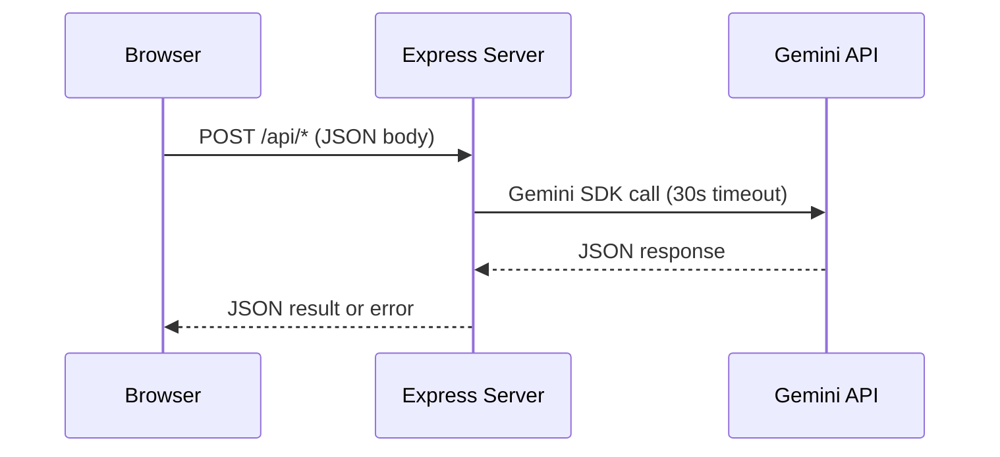
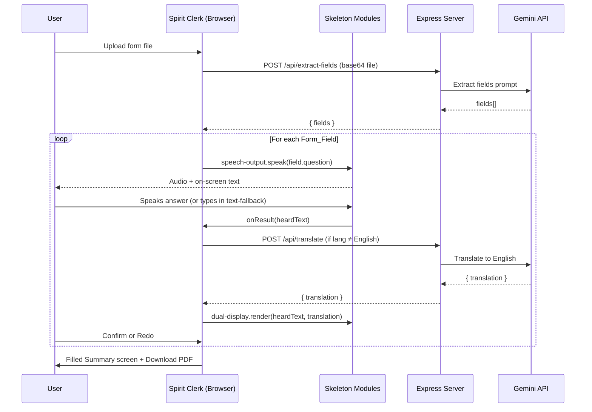
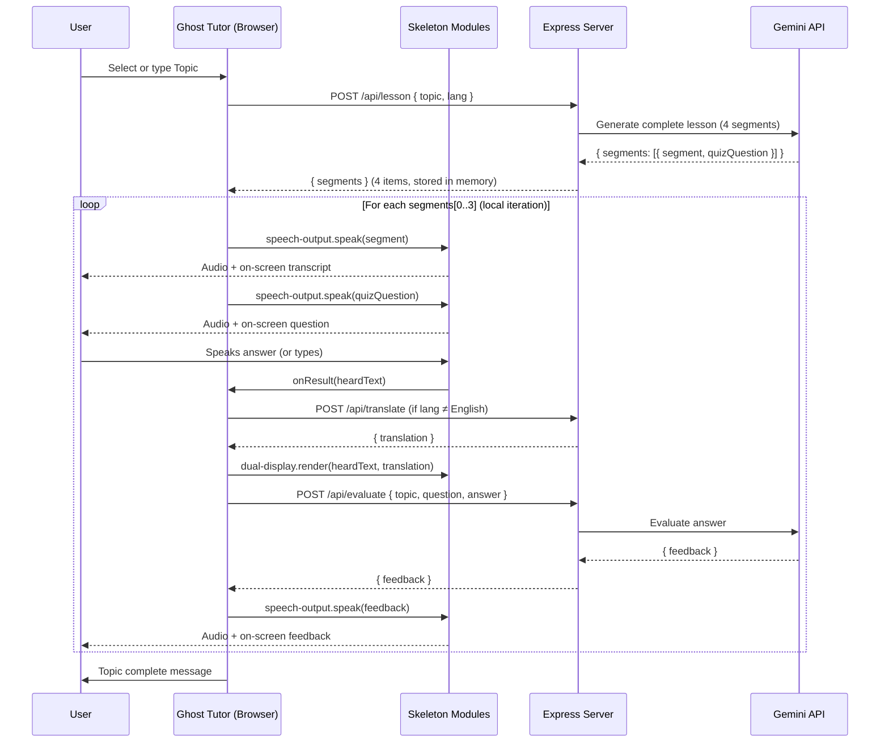

# Design Document

## Overview

Phantom Voice Kit is a voice-first web application skeleton built with plain HTML, CSS, and vanilla JavaScript ES modules on the frontend and a single Node.js Express server on the backend. The server serves all static files and proxies every Google Gemini API call so the API key never reaches the browser. Two applications — Spirit Clerk (voice-guided form filling) and Ghost Tutor (spoken topic lessons with quizzes) — are built on top of a shared `/skeleton` folder that provides speech input, speech output, language selection, dual-language display, text fallback, Halloween theming, and an API client module. A home screen at `index.html` ties both apps together with a shared language selector.

---

## Architecture

Three layers interact through clearly defined boundaries:

```
┌─────────────────────────────────────────────────┐
│  Browser                                        │
│  index.html / apps/spirit-clerk / apps/ghost-   │
│  tutor                                          │
│  Vanilla JS ES Modules, Web Speech API, jsPDF   │
│                │  HTTP POST /api/*              │
└────────────────┼────────────────────────────────┘
                 │
┌────────────────▼────────────────────────────────┐
│  Express Server  (http://localhost:3000)        │
│  server/index.js — static file serving +        │
│  route handlers                                 │
│                │  HTTPS Gemini SDK call         │
└────────────────┼────────────────────────────────┘
                 │
┌────────────────▼────────────────────────────────┐
│  Google Gemini API                              │
│  @google/genai, model from GEMINI_MODEL env var │
└─────────────────────────────────────────────────┘
```



The browser never calls Gemini directly. All AI interactions go through the Express server. The Express server does NOT mount `express.static` on the repository root. The Home Screen is served explicitly with:
```js
app.get('/', (req, res) => res.sendFile(path.join(ROOT, 'index.html')));
```
`express.static` is mounted only for `/skeleton` and `/apps`:
```js
app.use('/skeleton', express.static(path.join(ROOT, 'skeleton')));
app.use('/apps',     express.static(path.join(ROOT, 'apps')));
```
This ensures `server/`, `.kiro/`, `.env`, `package.json`, and `LICENSE` are never reachable from the browser.

---

## Folder Structure

```
/
├── skeleton/
│   ├── speech-input.js
│   ├── speech-output.js
│   ├── language-dropdown.js
│   ├── dual-display.js
│   ├── text-fallback.js
│   ├── nav-menu.js
│   ├── i18n.js
│   ├── locales/
│   │   ├── en.json
│   │   └── ta.json, hi.json, ... (20 files, one per language code)
│   ├── theme.css
│   └── api-client.js
│
├── apps/
│   ├── spirit-clerk/
│   │   ├── index.html
│   │   ├── app.js
│   │   └── style.css
│   └── ghost-tutor/
│       ├── index.html
│       ├── app.js
│       └── style.css
│
├── server/
│   ├── index.js          ← serves / via sendFile; mounts /skeleton and /apps via express.static
│   ├── gemini.js          ← shared Gemini client, timeout, JSON parsing
│   └── routes/
│       ├── translate.js
│       ├── extract-fields.js
│       ├── lesson.js
│       └── evaluate.js
│
├── index.html          ← Home Screen
├── .env                ← not committed
├── .env.example
├── .gitignore
├── LICENSE
├── package.json
└── README.md
```

---

## Skeleton Modules

### `speech-input.js`

Wraps the browser `SpeechRecognition` API. Exposes `createSpeechInput({ lang, onResult, onError })` which returns a controller object with `start()` and `stop()` methods. Internally configures `recognition.lang` to the BCP-47 code, sets a 30-second inactivity timer that calls `stop()` automatically and fires `onError({ inactivity: true })` to signal a silence timeout (distinct from recognition failure). Tracks a retry counter (max 3) for recognition failures before invoking `onError` with a `{ fallbackOnly: true }` flag. On a successful result, calls `onResult(heardText)` with the transcript string. `createSpeechInput` first checks for `window.SpeechRecognition` or `window.webkitSpeechRecognition`; if neither exists it returns `{ supported: false }`, and the app hides the microphone button, shows a short message that voice input is not available in this browser, and uses Text_Fallback only (R2.6).

### `speech-output.js`

Wraps `window.speechSynthesis`. Exposes `createSpeechOutput({ lang })` which returns an object with `speak(text, { onStart, onEnd, onError })` and `stop()`. On `speak()`, voice choice is delegated to the pure function `selectVoice(voices, bcp47)`, which prefers a voice whose name contains "Natural", then one whose name contains "Online", then the first matching voice (R3.5). If no matching voice is found, it calls `onError({ audioUnavailable: true })` and returns without speaking, leaving the caller to display the text. Fires `onStart` synchronously before audio begins so the UI can show the transcript text within 500 ms.

### `language-dropdown.js`

Exposes `createLanguageDropdown(containerEl, { onChange })`. On initialisation, reads `chosenLang` from `sessionStorage` and pre-selects that language; falls back to English (`en-US`) if `sessionStorage` has no value. Renders a `<select>` element populated with the 20 supported languages. Each option shows the language's own name in its own script followed by the English name, e.g. `தமிழ் (Tamil)`. It also calls `setLocale(bcp47)` from `i18n.js` so the UI language changes immediately. On change, updates `sessionStorage` (`chosenLang` and `chosenLangLabel`) and calls `onChange({ label, bcp47 })`. Also exports `getCurrentLanguage()` to read the active selection from anywhere.

### `dual-display.js`

Exposes `renderDualDisplay(containerEl, { heardText, englishMeaning })`. If `heardText` is empty (zero characters), the container is hidden. If `englishMeaning` is absent or null, only the `heardText` section is rendered with a note that the English meaning is unavailable. Otherwise, renders two labeled sections: one for the Chosen_Language text, one for the English meaning.

### `text-fallback.js`

Exposes `createTextFallback(containerEl, { onSubmit, onError })`. Renders a `<textarea>` (max 500 chars) and a submit button. Validates on submit: if the trimmed value is empty, calls `onError('empty')` with an inline validation message and does not call `onSubmit`. On a valid, non-whitespace submission, calls `onSubmit(text)`.

### `nav-menu.js`

Shared navigation header (Requirement 16). Exposes `createNavMenu(headerEl, { current, showBack, onBack, getLeaveMessage, onLeave })` and a small helper `createScreenHistory(firstScreen)`.

**Header layout:** `headerEl` becomes a top bar (`.nav-header`) with a left group (hamburger button, then a "← Back" button) and a right slot that holds the language dropdown. `createNavMenu` returns `{ languageEl, setBackVisible(visible), closeMenu() }`; the page passes `languageEl` to `createLanguageDropdown` so the dropdown sits on the right of the bar. `showBack: false` (home screen) hides the Back button.

**Drawer:** A `<nav>` drawer and a dimmed overlay are appended to `document.body`. The drawer slides in from the left (CSS transform) and lists Home (`/`), Spirit Clerk and Ghost Tutor. The link whose id equals `current` (`'home' | 'spirit-clerk' | 'ghost-tutor'`) gets `aria-current="page"` and a highlight class. The hamburger has `aria-controls`, `aria-expanded` (true/false) and an `aria-label` ("Open menu" / "Close menu"). The drawer closes on a link click, an overlay (outside) click, or the Escape key (focus returns to the hamburger). While closed it is `inert` / `visibility: hidden` so it is not reachable by keyboard.

**Screen history:** `createScreenHistory(firstScreen)` returns `{ visit(name), back(), current(), canGoBack() }`. `visit` pushes a screen (or truncates the stack if the screen is already in it, so it never grows in a loop); `back` pops and returns the previous screen name. Each app creates one history, calls `visit` whenever it shows a screen, and passes an `onBack` callback.

**Back behaviour:** `onBack()` is called first. It returns `true` if the app handled it by showing the previous screen. If it returns `false` (or is not provided), the module navigates to `/`. So on an app's first screen Back goes Home.

**Leave guard:** Before any navigation (Back to Home, or a drawer link) the module calls `getLeaveMessage()`. If it returns a string, `window.confirm(message)` is shown and navigation continues only if the user accepts. Spirit Clerk returns "Your answers will be lost. Go back?" while the form-fill screen is active and not finished; the same message is used when Back would leave the form-fill screen for the upload screen.

**Speech:** Every navigation first calls `window.speechSynthesis.cancel()` and the optional `onLeave()` hook (apps use it to stop the microphone). A `pagehide` listener also cancels speech.

### `i18n.js` and `locales/*.json`

Localization (Requirement 17). All fixed UI strings live in `skeleton/locales/<code>.json`, a flat `{ "key.name": "text" }` object where `<code>` is the part of the BCP-47 code before the dash (`en`, `ta`, `hi`, `zh`, `pt`, ...). `en.json` is the source of truth; the other 19 files have exactly the same keys.

`i18n.js` exports:

- `initI18n()` - async; loads English (the fallback) and the language in `sessionStorage.chosenLang`, sets `<html lang dir>`, and calls `applyTranslations(document)`. Pages `await` it before building their UI.
- `setLocale(bcp47)` - async; loads (and caches) the file, makes it current, updates `lang` and `dir` (`rtl` for `ar` and `ur`), re-applies translations to the whole document, then notifies listeners.
- `onLocaleChange(callback)` - lets an app re-render text it built from code.
- `t(key, params)` - returns the text for the current language, falling back to English, then to the key itself. `{name}` placeholders are replaced from `params`.
- `applyTranslations(root)` - translates every element under `root` with `data-i18n="key"` (sets `textContent`) and `data-i18n-attr="aria-label:key;placeholder:key"` (sets attributes). `data-i18n-params` holds optional JSON params.
- `setI18nText(el, key, params)` / `setI18nAttr(el, attr, key)` - helpers used by code that creates text at run time. They write the `data-*` attributes first, so the text is re-translated automatically when the language changes (no re-render code needed for messages and labels).

**Direction:** `ar` and `ur` set `dir="rtl"`. CSS uses logical properties (`margin-inline-start`, `padding-inline`, `border-inline-start`, `inset-inline-start`, `text-align: start/end`), and the Navigation_Header drawer uses `[dir="rtl"]` to slide in from the right.

**PDF:** The Spirit Clerk PDF is not localized; its title and placeholders stay English ("Form:", "(skipped)", "(translation unavailable)").

**Keeping files in sync:** A Kiro hook (`.kiro/hooks/sync-locales.kiro.hook`) runs when `en.json` is saved and asks the agent to add new or changed keys to the other 19 files, remove deleted keys, and never rename keys. A unit test (task 11.9) checks that all files have the same keys as `en.json` and no empty values.

### `theme.css`A stylesheet imported by all pages. Defines CSS custom properties for the Halloween palette (dark purples, oranges, ghost-white), typography (`@font-face` or Google Fonts with a fallback stack), ghost-themed iconography via CSS masks or inline SVG, styles for the Navigation_Header (`.nav-header`, hamburger, Back button, drawer, overlay), and a mobile-first responsive baseline ensuring 44×44 px minimum touch targets and no horizontal overflow on widths 320–767 px. Asset load failures are handled by CSS fallbacks (background-color instead of background-image, etc.).

### `api-client.js`

Exposes one async function per backend route:

```js
translate({ text, targetLang })          → { translation }
extractFields({ fileBase64, mimeType, lang }) → { fields: [{ label, inputType, question }] }
lesson({ topic, lang }) → { segments: [{ segment, quizQuestion }] }
evaluate({ topic, question, answer, lang }) → { feedback }
```

Each function calls the corresponding `POST /api/*` endpoint, enforces a 5-second client-side timeout for translation calls (per R2.3 / R2.5) and 25-second for lesson (R11.4), surfaces structured `{ error }` objects on failure, and never includes any API key.

---

## Components and Interfaces

### Skeleton Components

| Component | File | Exported Interface |
|---|---|---|
| SpeechInput | `skeleton/speech-input.js` | `createSpeechInput({ lang, onResult, onError }) → { start(), stop() }` |
| SpeechOutput | `skeleton/speech-output.js` | `createSpeechOutput({ lang }) → { speak(text, { onStart, onEnd, onError }), stop() }` |
| LanguageDropdown | `skeleton/language-dropdown.js` | `createLanguageDropdown(el, { onChange }) → void`; `getCurrentLanguage() → { label, bcp47 }`; reads/writes `sessionStorage.chosenLang` |
| DualDisplay | `skeleton/dual-display.js` | `renderDualDisplay(el, { heardText, englishMeaning }) → void` |
| TextFallback | `skeleton/text-fallback.js` | `createTextFallback(el, { onSubmit, onError }) → void` |
| I18n | `skeleton/i18n.js` | `initI18n()`, `setLocale(bcp47)`, `onLocaleChange(cb)`, `t(key, params)`, `applyTranslations(root)`, `setI18nText(el, key, params)`, `setI18nAttr(el, attr, key)` |
| NavMenu | `skeleton/nav-menu.js` | `createNavMenu(headerEl, { current, showBack, onBack, getLeaveMessage, onLeave }) → { languageEl, setBackVisible(v), closeMenu() }`; `createScreenHistory(first) → { visit, back, current, canGoBack }` |
| APIClient | `skeleton/api-client.js` | `translate()`, `extractFields()`, `lesson()`, `evaluate()` (see Skeleton Modules) |

### Backend Route Handlers

| Handler | File | Depends On |
|---|---|---|
| gemini | `server/gemini.js` | `@google/genai`, `dotenv` |
| translate | `server/routes/translate.js` | `server/gemini.js` |
| extractFields | `server/routes/extract-fields.js` | `server/gemini.js` |
| lesson | `server/routes/lesson.js` | `server/gemini.js` |
| evaluate | `server/routes/evaluate.js` | `server/gemini.js` |

### App Pages

| App | Entry Point | Key Components Used |
|---|---|---|
| Home Screen | `index.html` | `nav-menu.js`, `language-dropdown.js`, `theme.css` |
| Spirit Clerk | `apps/spirit-clerk/index.html` + `app.js` | All skeleton modules |
| Ghost Tutor | `apps/ghost-tutor/index.html` + `app.js` | All skeleton modules |

---

## Data Models

### Language Entry

```js
{
  label: string,      // Display name e.g. "Tamil"
  bcp47: string       // BCP-47 code e.g. "ta-IN"
}
```

### Form Field (Spirit Clerk)

```js
// Form Field (Spirit Clerk)
{
  label: string,                                          // e.g. "Date of Birth"
  inputType: "text" | "date" | "checkbox" | "selection",
  question: string                                        // spoken question in Chosen_Language
}
```

### Field Answer (Spirit Clerk)

```js
// Field Answer (Spirit Clerk)
{
  field: FormField,
  heardText: string,      // transcript in Chosen_Language (empty string if skipped)
  englishMeaning: string, // English translation of heardText (empty string if not yet available)
  skipped: boolean
}
```

> The Filled_Summary and PDF use `englishMeaning` as the answer text. If `englishMeaning` is an empty string on a non-skipped answer when the summary is about to be shown, Spirit Clerk calls `translate()` for those answers before rendering the summary screen.

### Lesson Response (Ghost Tutor)

```js
// Lesson Response (Ghost Tutor)
{
  segments: [{ segment: string, quizQuestion: string }]  // always 4 items
}
```

### API Error Response (shared)

```js
{
  error: string    // safe description; never contains API key or stack trace
}
```

### Session State (stored in sessionStorage)

```js
{
  chosenLang: string,       // BCP-47 code
  chosenLangLabel: string   // display name
}
```

---

## Backend Routes

All routes accept and return `application/json`. Every Gemini call is wrapped in a `Promise.race` with a 30-second `AbortSignal` / timeout reject. On timeout the route returns `{ error: 'timeout' }` with HTTP 504. On Gemini error the route returns `{ error: '<safe description>' }` with HTTP 502, omitting the API key and internal stack trace.

All Gemini calls set `responseMimeType: 'application/json'` in the generation config to request structured JSON output.

> The Express server configures `express.json({ limit: '15mb' })`. A 10 MB binary file encodes to approximately 13.4 MB as base64, so the 15 MB limit accommodates the maximum allowed upload size.

### Shared Server Modules

**`server/gemini.js`** — Creates a single `GoogleGenAI` client (imported as `import { GoogleGenAI } from '@google/genai'`) from `GEMINI_API_KEY` and exports a `callGemini({ prompt, inlineParts })` async function. This function: (1) calls `ai.models.generateContent({ model, contents, config })` where `config` includes `responseMimeType: 'application/json'` and `thinkingConfig: { thinkingBudget: 0 }`, (2) wraps the SDK call in `Promise.race` with a 30-second `AbortSignal` timeout, (3) parses and returns the JSON response, (4) throws a structured error `{ code: 'timeout' }` on timeout, `{ code: 'rate_limit' }` on HTTP 429 from Gemini, and `{ code: 'gemini_error', message }` on other Gemini errors. All route files import and use `callGemini` instead of creating their own clients or managing timeouts individually.

### POST /api/translate

| Field | Detail |
|---|---|
| Request body | `{ text: string, targetLang: string }` |
| Response | `{ translation: string }` |
| Prompt strategy | "Translate the following text to `{targetLang}`. Transliterate or keep as-is (do not translate by meaning) any proper names, numbers, dates, email addresses, phone numbers, and postal addresses. Reply with a JSON object `{ translation: string }`. Text: `{text}`" |
| Timeout | 30 s via `gemini.js` → HTTP 504 |
| Validation | Returns HTTP 400 if `text` is empty |

### POST /api/extract-fields

| Field | Detail |
|---|---|
| Request body | `{ fileBase64: string, mimeType: 'application/pdf' \| 'image/jpeg' \| 'image/png' \| 'image/webp', lang: string }` |
| Response | `{ fields: [{ label: string, inputType: 'text'\|'date'\|'checkbox'\|'selection', question: string }] }` |
| Prompt strategy | Sends the base64-encoded file as an inline part. "Identify all form fields in this document. For each field, also generate a short, friendly spoken question in `{lang}` regardless of what language the form is written in. Return a JSON array `fields` where each item has `label` (string), `inputType` (one of: text, date, checkbox, selection), and `question` (string, the spoken question in `{lang}`)." |
| Timeout | 30 s via `gemini.js` → HTTP 504 |
| Validation | Returns HTTP 400 if `fileBase64` is empty or `mimeType` is unsupported |

### POST /api/lesson

| Field | Detail |
|---|---|
| Request body | `{ topic: string, lang: string }` |
| Response | `{ segments: [{ segment: string, quizQuestion: string }] }` — always exactly 4 items |
| Prompt strategy | "You are a friendly tutor. Generate a complete lesson on the topic `{topic}` as exactly 4 short segments. Each segment has a spoken explanation and a follow-up quiz question, both in `{lang}`. Reply with JSON: `{ segments: [{ segment, quizQuestion }] }` with exactly 4 items." |
| Timeout | 30 s via `gemini.js` → HTTP 504 |
| Validation | Returns HTTP 400 if `topic` is empty or whitespace |

### POST /api/evaluate

| Field | Detail |
|---|---|
| Request body | `{ topic: string, question: string, answer: string, lang: string }` |
| Response | `{ feedback: string }` |
| Prompt strategy | "Evaluate the following answer to a quiz question about `{topic}`. Provide brief spoken feedback in `{lang}`. JSON: `{ feedback: string }`. Question: `{question}`. Answer: `{answer}`." |
| Timeout | 30 s via `gemini.js` → HTTP 504 |
| Validation | Returns HTTP 400 if `answer` is empty |

---

## Frontend Pages

### Home Screen (`index.html`)

**Imports:** `i18n.js`, `nav-menu.js`, `language-dropdown.js`, `theme.css`

**Screen flow:** Single screen. On load, renders the Navigation_Header (menu button visible, Back hidden) with the language dropdown on its right, and the Halloween-themed home screen with the language selection (English pre-selected), a "Spirit Clerk" button, and a "Ghost Tutor" button. The selected language is stored in `sessionStorage` under `chosenLang` (BCP-47 code) and `chosenLangLabel`. Clicking "Spirit Clerk" navigates to `apps/spirit-clerk/index.html`; clicking "Ghost Tutor" navigates to `apps/ghost-tutor/index.html`. The screen also shows a small tip with the exact text "For the best voices in Indian languages, open this app in Microsoft Edge." (R13.8).

**Key interactions:** Language change updates `sessionStorage` immediately. Navigation preserves the selection because both child apps read `sessionStorage` on load.

---

### Spirit Clerk (`apps/spirit-clerk/`)

**Imports:** `nav-menu.js`, `speech-input.js`, `speech-output.js`, `dual-display.js`, `text-fallback.js`, `api-client.js`, `language-dropdown.js`, `theme.css`

**Screen flow:**

1. **Upload screen** — file input accepting PDF/JPEG/PNG/WEBP ≤ 10 MB. Validates size and type client-side before sending. On confirm, calls `extractFields()` and shows a loading spinner. On success, advances to the form-fill screen. On zero fields, shows a retry message.
2. **Form-fill screen** — iterates `fields[]` in order. For each field, uses `field.question` (returned directly by `extractFields()`) as the spoken question, speaks it via `speech-output.js`, displays it, and waits for voice input (`speech-input.js`) or text fallback. Shows `dual-display.js` with Heard_Text + English_Meaning. Presents confirm / redo controls. Tracks redo count (max 3, then skips). Silence handling follows R9.5: if no voice input and no text-fallback is received within 30 seconds of asking a question, the app re-asks the same question once. If a further 30 seconds pass with no input, the field is marked as skipped and the app advances to the next field. This 30-second inactivity timer is managed by `speech-input.js`; Spirit Clerk listens for the `onError({ inactivity: true })` event to trigger the re-ask or skip logic, tracking a `silenceCount` per field (max 1 re-ask before skip).
3. **Filled summary screen** — before rendering, checks all non-skipped `FieldAnswer` entries for empty `englishMeaning` and calls `translate()` for any that are missing. Then lists all field-answer pairs in document order using `englishMeaning` as the answer text, counts skipped fields, and provides a "Download PDF" button (jsPDF from CDN). PDF filename: `{formName}_{YYYY-MM-DD}.pdf`. On PDF error, retains the summary.

The language dropdown is displayed in the page header. When the user changes the language, the Spirit Clerk re-creates the active `SpeechInput` and `SpeechOutput` instances with the new BCP-47 code (after any in-progress speech completes), satisfying R1.3.

**Navigation:** The page header is the shared Navigation_Header (menu drawer with Home / Spirit Clerk / Ghost Tutor links, Back button, language dropdown on the right); there is no separate Home button. Screens are `upload` -> `form-fill` -> `summary` and are tracked with `createScreenHistory('upload')`. Back on the summary screen returns to the last question of the form-fill screen (answers are kept); Back on the form-fill screen asks "Your answers will be lost. Go back?" and then returns to the upload screen; Back on the upload screen goes to Home. The same confirmation is shown when a drawer link is used during form-fill. Speech and the microphone are stopped on every navigation.

---

### Ghost Tutor (`apps/ghost-tutor/`)

**Imports:** `nav-menu.js`, `speech-input.js`, `speech-output.js`, `dual-display.js`, `text-fallback.js`, `api-client.js`, `language-dropdown.js`, `theme.css`

**Screen flow:**

1. **Topic selection screen** — displays 5–20 suggested topic buttons plus a free-text input (max 100 chars). Validates non-empty on submit. Calls `lesson({ topic, lang })` with a 25-second client-side timeout. Stores the returned `segments` array (4 items) in memory. Shows a loading indicator.
2. **Lesson screen** — iterates through `segments[0]` through `segments[3]` locally. Speaks each `segment` via `speech-output.js`, displays transcript within 500 ms of audio start. Then speaks the `quizQuestion`, displays it, and opens a 30-second answer window. On timeout, re-asks once. Accepts voice or text fallback, shows `dual-display.js`, then calls `evaluate()`. On eval timeout (10 s client-side), re-asks the question. `hasMore` is computed locally: `true` while `segmentIndex < 3`, `false` when `segmentIndex === 3` and feedback has been delivered.
3. **Feedback display** — speaks and displays `feedback`. If `hasMore` is true, advances to next segment (`segmentIndex + 1`). If false, speaks and displays a topic-complete message. No further calls to `/api/lesson` are made.

The language dropdown is displayed in the page header. When the user changes the language, the Ghost Tutor re-creates the active `SpeechInput` and `SpeechOutput` instances with the new BCP-47 code (after any in-progress speech completes), satisfying R1.3.

**Navigation:** The page header is the shared Navigation_Header (menu drawer with Home / Spirit Clerk / Ghost Tutor links, Back button, language dropdown on the right); there is no separate Home button. Screens are `topic` -> `lesson` and are tracked with `createScreenHistory('topic')`; Back on the lesson screen returns to topic selection, and Back on topic selection goes to Home. Speech is stopped on every navigation.

---

## Language and Speech

### Language-to-BCP47 Map

| Language | BCP-47 Code |
|---|---|
| English | `en-US` |
| Tamil | `ta-IN` |
| Hindi | `hi-IN` |
| Telugu | `te-IN` |
| Kannada | `kn-IN` |
| Malayalam | `ml-IN` |
| Korean | `ko-KR` |
| Chinese (Simplified) | `zh-CN` |
| Japanese | `ja-JP` |
| Spanish | `es-ES` |
| French | `fr-FR` |
| Arabic | `ar-SA` |
| Portuguese (Brazil) | `pt-BR` |
| Russian | `ru-RU` |
| Bengali | `bn-IN` |
| Urdu | `ur-PK` |
| Indonesian | `id-ID` |
| German | `de-DE` |
| Vietnamese | `vi-VN` |
| Turkish | `tr-TR` |

The dropdown shows each language by its native name followed by the English name, e.g. `தமிழ் (Tamil)`, `हिन्दी (Hindi)`, `中文 (Chinese)`. The `label` stored in `sessionStorage.chosenLangLabel` and passed to `translate()` stays the English name (e.g. `Hindi`).
### SpeechRecognition Language Setting

`SpeechRecognition.lang` is set to the BCP-47 code before each `start()` call. This is done inside `speech-input.js` using the `lang` parameter passed at construction time. When the user changes the Chosen_Language mid-session, the current `SpeechInput` instance is stopped and a new one is created with the updated BCP-47 code after any in-progress `speechSynthesis` utterance ends (detected via the `onEnd` callback of `speech-output.js`).

### speechSynthesis Voice Selection

`speech-output.js` runs the following selection algorithm on `speak()`:

1. Call `window.speechSynthesis.getVoices()` (or listen for `voiceschanged` on first call).
2. Collect voices where `voice.lang === bcp47` (exact matches). If any, pick by preference: first voice whose name contains "Natural"; else first whose name contains "Online"; else the first match.
3. If no exact match, collect voices where `voice.lang.startsWith(bcp47.split('-')[0])` and apply the same preference (Natural, then Online, then first).
4. If still no match, return `null`: do NOT speak. Call `onError({ audioUnavailable: true })`, display the text and the "audio unavailable" inline note (R3.3).

---

## Data Flow Diagrams

### (a) Spirit Clerk Form-Fill Flow



### (b) Ghost Tutor Lesson Flow



---

## Error Handling

### Frontend Layer

| Scenario | Behaviour |
|---|---|
| `SpeechRecognition` returns empty / error | Show error message + retry prompt; after 3 failures switch to Text_Fallback only (R2.4) |
| Translation times out (5 s client-side) | Show Heard_Text without English_Meaning + inline note (R2.5, R5.5) |
| Browser has no `SpeechRecognition` (`createSpeechInput` returns `{ supported: false }`) | Hide microphone button, show short "voice input is not available in this browser" message, use Text_Fallback only (R2.6) |
| `speechSynthesis` unavailable for lang | Show text on screen + inline "audio unavailable" note (R3.3) |
| `speechSynthesis` interrupted mid-utterance | Stop, show remaining text + inline "audio interrupted" note (R3.4) |
| File too large / wrong type | Inline error, do not clear existing form data (R8.4) |
| Zero fields extracted | Inline message + retry prompt (R8.6) |
| Lesson fetch > 25 s | Show error, preserve topic selection (R11.4) |
| Eval response > 10 s | Show error, re-ask quiz question (R12.7) |
| PDF generation fails | Show error, retain Filled_Summary on screen (R10.4) |
| Theme asset fails to load | CSS fallback (colour / font stack) maintains layout (R6.4) |
| Server returns HTTP 429 | Display inline message: "The spirits are busy, please try again in a minute." Preserve all current state so the user can retry without re-entering data. |

### Backend Layer

| Scenario | Behaviour |
|---|---|
| Empty / invalid request body | Return HTTP 400 `{ error: 'invalid_input' }` — no Gemini call made |
| Gemini API error response | Return HTTP 502 `{ error: '<safe description>' }` — no key or stack trace |
| Gemini call exceeds 30 s | Return HTTP 504 `{ error: 'timeout' }` |
| Gemini returns HTTP 429 | Return HTTP 429 `{ error: 'busy' }` — the client should retry after a delay |
| Unhandled server error | Return HTTP 500 `{ error: 'internal_error' }` — Express error middleware strips stack in production |

---

## Configuration

> The Express server configures `express.json({ limit: '15mb' })`. A 10 MB binary file encodes to approximately 13.4 MB as base64, so the 15 MB limit accommodates the maximum allowed upload size.

### Environment Variables

| Variable | Description |
|---|---|
| `GEMINI_API_KEY` | Google Gemini API key. Required. Never committed. |
| `GEMINI_MODEL` | Gemini model name (e.g. `gemini-3.5-flash`). Required. |
| `PORT` | Server port. Optional, defaults to `3000`. |

### `.env.example`

```
GEMINI_API_KEY=your_api_key_here
GEMINI_MODEL=gemini-3.5-flash
PORT=3000
```

> `GEMINI_MODEL` should be set to a current Flash model listed in Google AI Studio. `gemini-3.5-flash` is the recommended default.

### `.gitignore` entries

```
node_modules/
.env
```

The `.kiro` folder is NOT in `.gitignore` (R15.3), so spec and config files are committed.

---

## Testing Strategy

Tests use Node's built-in test runner (`node --test`) and [fast-check](https://github.com/dubzzz/fast-check) for property-based tests. The Gemini module (`server/gemini.js`) is mocked in all automated tests — no test ever calls the real Gemini API. Integration tests with the real API are manual only and are not run automatically.

### Pure Functions

To enable testing without a browser or live API, the following logic is extracted into small pure functions (in standalone `.js` files importable by Node):

| Pure Function | Location | What it tests |
|---|---|---|
| `selectVoice(voices, bcp47)` | `skeleton/speech-output-utils.js` | Voice selection algorithm (exact match, prefix match, no-match → null; for both exact and prefix matches, Natural > Online > first) |
| `validateText(value)` | `skeleton/text-fallback-utils.js` | Returns `'empty'` for blank/whitespace, `'ok'` otherwise |
| `nextRedoOrSkip(redoCount)` | `apps/spirit-clerk/form-utils.js` | Returns `'redo'` if `redoCount < 3`, `'skip'` if `redoCount >= 3` |
| `nextSilenceOrSkip(silenceCount)` | `apps/spirit-clerk/form-utils.js` | Returns `'reask'` if `silenceCount < 1`, `'skip'` if `silenceCount >= 1` |
| `pdfFilename(formName, date)` | `apps/spirit-clerk/form-utils.js` | Returns `'{formName}_{YYYY-MM-DD}.pdf'` |
| `computeHasMore(segmentIndex)` | `apps/ghost-tutor/lesson-utils.js` | Returns `true` if `segmentIndex < 3`, `false` if `segmentIndex === 3` |

### Unit Tests

| Area | What to test |
|---|---|
| `selectVoice` | Exact match returned; prefix match returned when no exact; `null` returned when no match; Natural > Online > first preference applied for both exact and prefix matches |
| `validateText` | Empty string → `'empty'`; whitespace-only → `'empty'`; valid text → `'ok'` |
| `nextRedoOrSkip` | Returns `'redo'` for counts 0, 1, 2; returns `'skip'` for count 3 |
| `nextSilenceOrSkip` | Returns `'reask'` for count 0; returns `'skip'` for count 1 |
| `pdfFilename` | Returns correct `'{name}_{YYYY-MM-DD}.pdf'` format for given inputs |
| `computeHasMore` | Returns `true` for indexes 0–2; `false` for index 3 |
| Backend routes (mocked Gemini) | HTTP 400 on empty input; HTTP 504 on timeout; HTTP 502 on Gemini error; HTTP 429 on rate-limit; response body never contains `GEMINI_API_KEY` value |

### Property-Based Tests (fast-check, minimum 100 iterations each)

Tag format: `// Feature: phantom-voice-kit, Property {N}: {property_text}`

See **Correctness Properties** section for the three properties to implement as fast-check tests.

### Integration Tests (manual only)

Not run automatically. Run manually against a live `.env` to verify end-to-end wiring:

- `/api/translate` — example translations confirm the Gemini call is wired correctly
- `/api/extract-fields` — a known test PDF returns expected field labels and questions
- `/api/lesson` — a known topic returns exactly 4 segments, each with non-empty `segment` and `quizQuestion`
- Full Spirit Clerk flow — upload → extract → fill → summary renders correctly
- Full Ghost Tutor flow — topic select → lesson → quiz × 4 → completion message

---

## Correctness Properties

*A property is a characteristic or behavior that should hold true across all valid executions of a system — essentially, a formal statement about what the system should do. Properties serve as the bridge between human-readable specifications and machine-verifiable correctness guarantees.*

### Property 1: Translation non-empty preservation

*For any* non-empty, non-whitespace input string submitted to the `/api/translate` endpoint with a valid target language, the returned `translation` field SHALL be a non-empty string.

**Validates: Requirements 2.3, 5.4**

### Property 2: Field extraction response shape validity

*For any* valid form image or PDF submitted to `/api/extract-fields`, every item in the returned `fields` array SHALL have `inputType` equal to one of `text`, `date`, `checkbox`, or `selection`, AND a non-empty `question` string.

**Validates: Requirements 8.3, 9.2**

### Property 3: Text Fallback whitespace rejection

*For any* string composed entirely of whitespace characters (spaces, tabs, newlines), submitting it via the Text_Fallback SHALL not advance the flow and SHALL leave the task list / field state unchanged.

**Validates: Requirements 5.3, 11.3**
